# EQLWiki — Eye of Zomm

**Eye of Zomm** is a local-first Windows and Linux app for **EverQuest Legends**. It reads ordinary game logs, combines them with cached EQLWiki knowledge, and keeps maps, named-mob loot, combat parses and triggers in separate desktop windows.

[Download Windows / Linux](https://github.com/Maergoth/EQL-EOZ/releases) · [EQLWiki](https://eqlwiki.com) · [Report an issue](https://github.com/Maergoth/EQL-EOZ/issues) · [Changelog](CHANGELOG.md)

**0.9.15: verified discoveries, zones and map controls.** Automatic discoveries stay hidden until a live public wiki check confirms the gap. Known cached facts avoid network requests; failed or inconclusive checks remain quiet. Red × dismisses a discovery, and ∞× permanently ignores its NPC/item until restored in Contribution History. New zone pages use one normal/raid blueprint with overview and Map placeholders. Log zone anchoring and same-visit numeric /con suggestions preserve evidence, while the top 3D map supports visible player markers and left-drag pan. See [release verification](docs/RELEASE_0915_PLAN.md).

**0.9.14: contribution history and safer loot discovery.** Open
**Contribute → Contribution History** to see this device's automatic and reviewed submissions
for your signed-in wiki account, including partly saved and unconfirmed results.
Saved pages offer revision and diff links. Discoveries and History share the
Contribute section and account controls; a compact reader toolbar and latest
result keep the discovery queue close at hand. History preserves drafts and
pauses its owned reader while open. It never retries a submission.
Explicit owner-labelled pets stay out of monster discoveries and contribution
plans. Common/Unique loot placement uses distinct monsters across the cached
wiki dataset: six or more means Common; fewer means Unique only when the count
is complete. No live counter requests are made. Shared item rules revision 2
also corrects positive primary-stat flooring: base HP 50 shows 75 at rank 5
with 4/32 progress. AC, HP, Mana, Endurance and regeneration also count toward
the two-stat requirement for rank-based Void. Saved base-recovery reviews from
older formulas require review after updating. Missing-wiki notices now appear
in their own lower-right desktop popup, including when Timers is closed.
Item notices check cached page membership first, then a bounded public existence
lookup when necessary; unverified failures show no missing-page claim. See
[the history guide](docs/CONTRIBUTION_HISTORY.md),
[cached loot classification](docs/CONTRIBUTION_LOOT_CLASSIFICATION.md),
[item discovery checks](docs/ITEM_DISCOVERY_EXISTENCE.md), and
[the release record](docs/RELEASE_0914_PLAN.md).

Items adds **Any** before **Auto** to browse every class without changing the
character profile. Contributions preserve documented item sets instead of
repeating their covered members. Rich item previews share a 350 ms mouseover
delay, and Intel keeps its scrolling list intact during unrelated updates.

**0.9.13: correct tier-zero verification category.** Ranked and recovered item
pages now use the exact
[Tier 0 Verification Needed](https://eqlwiki.com/Category:Tier_0_Verification_Needed)
category title. Accepted tier-zero readings recognize app-marked membership in
either capitalization while preserving manually assigned categories.

**0.9.12: shared wiki item formulas and tier-zero verification.** Item-tier
previews use the wiki-owned engine and rules bundled with the app. Each release
resolves one formula snapshot for both Windows and Linux; installed apps receive
formula changes through app updates, without background formula requests.
Backstab, weapon Accuracy, Void resist, weight and tier limits now agree with
the wiki. Recorded Character totals remain unchanged. New item pages based on
unverified ranked or recovered values join
[Tier 0 verification needed](https://eqlwiki.com/Category:Tier_0_verification_needed).

**0.9.11: automatic contribution reading and chat item detection.** Open
Contribute, then open the selected item’s examine window in EverQuest. A gentle
reader proposes matching stats, stages a reliable item screenshot and helps
find its icon. Pause it in place; manual edits and Character capture stay
protected. A fresh, sufficiently clear new-item reading can create its page
automatically after live duplicate checks; ambiguous cases stay for review.
Tiered item mentions can now be recognized even when game logs omit link codes.
See [the follow-up and release record](docs/CHAT_CAPTURE_FOLLOWUP_PLAN.md).

**0.9.10: reliable overlays and streamlined wiki contributions.** Gently drag
a snapped overlay to detach it; its size and neighbors stay put. Release near a
new edge to dock. Item hovers across the app and native Intel now use the wiki's
item frame, inline stats and linked effects, retaining Character tier and
Exaltation controls. The minimap shows travel direction from logged movement.

Contribute uses fixed-choice class/slot dropdowns, shared Zone, screenshot and
inline icon paste, targeted additions and a clear Preview → Publish flow. Tiered
item evidence prefills editable compatible base proposals. Successful changes
link to the saved pages. Missing wiki items linked in chat offer Contribute;
accepted item/monster prompts wait for matching live examine evidence or the
fresh next `/loc`, show green completion and then close. Character capture and
existing readers stay protected. See [the release record](docs/RELEASE_0910_PLAN.md)
for integration, verification and publication status.

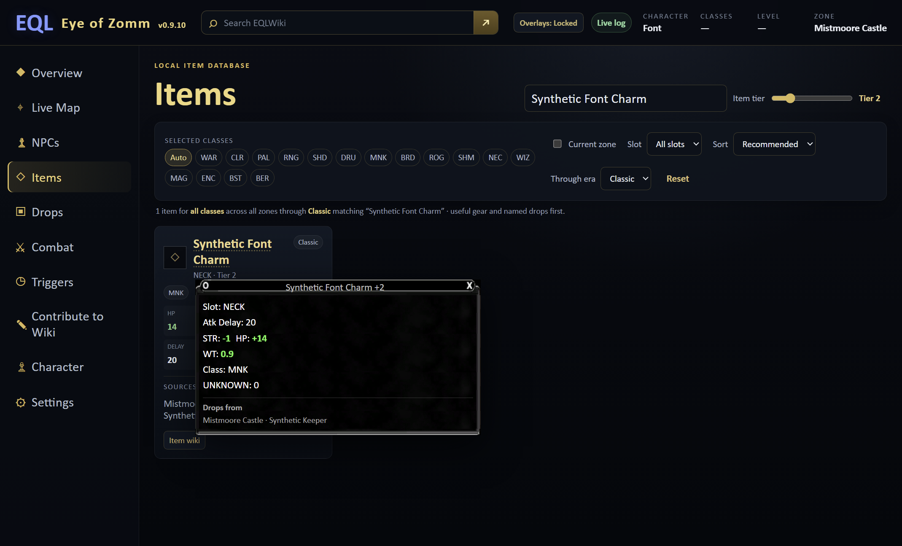

The illustrated What's new archive retains every earlier update and its
screenshots. Release captures use synthetic records and isolated profiles/APIs;
they contain no player pixels or production wiki submissions.

Keep all gear on. Enter character details, type
`/outputfile inventory`, then let EoZ detect the fresh matching export in your
chosen game folder. Next, **Open your Inventory → Scroll down → Click off your
buffs**, select the game window and review its fully equipped, unbuffed stats.
Character totals use only that reviewed reading; item/catalog values and older
baselines are never added. Character does not collect gear by item OCR.

Missing wiki items and Exaltations leave public slots/sockets empty. Use Contribute
to supply missing details, sync the accepted wiki data and export inventory again.
Optional local stat/examine reading uses a lower **1 FPS** cadence for stable
panes. See [the inventory-export flow](docs/CHARACTER_WALKTHROUGH.md) and
[inventory-export design](docs/INVENTORY_EXPORT_CHARACTER_PLAN.md).

The compact inspect and interactive wiki sharing introduced in 0.9.6 remain:
24 equipment slots including two Any slots, clickable known gear/Exaltations,
PNG copy/save and an interactive share with one final Share action. Since 0.9.8 new shares
target your **User:Name** page. Character Select preserves
separate **Character (Server)** saves. The wiki contract and activation boundary
are documented in [the cross-repository plan](docs/CHARACTER_SHEETS_PLAN.md).

The following images show the **0.9.8 components with synthetic
records** in Chromium. They are interface evidence, not live-game capture or
production wiki submissions. Older tours remain available in What's new.

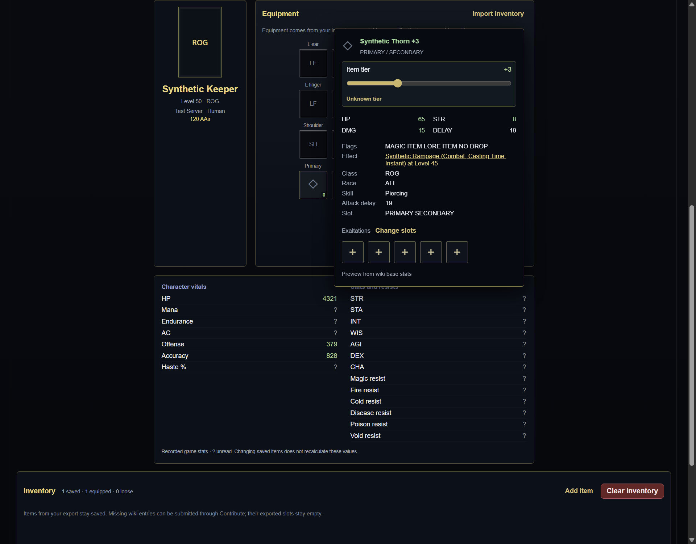

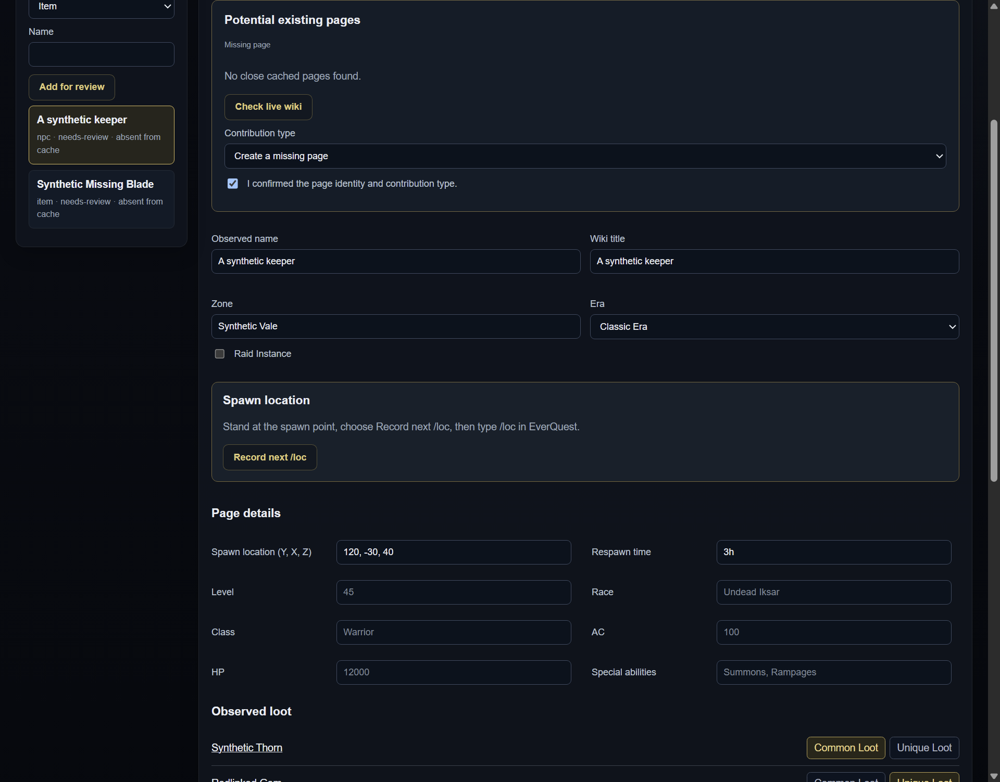

In **Settings → Screen reading**, explicitly select the source you want to read.
The supported calibration is **Default Modern (`default_modern`)**; other game
skins remain unverified. Calibration can select a complete stat or examine pane,
and **Full frame** resets it. Original source/session/generation and timestamp
checks still apply. Ordinary log parsing does not require screen reading.

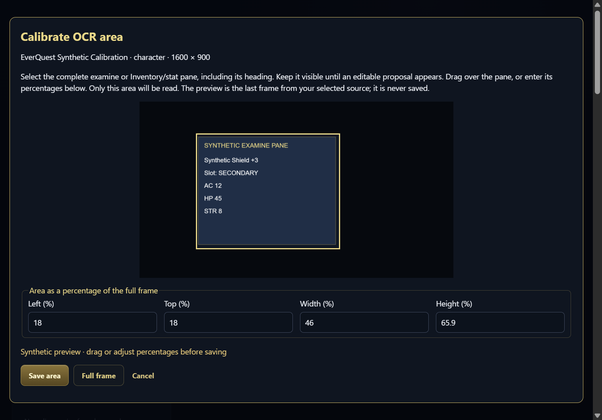

## Get started

1. Download the latest Windows `Setup-<version>-x64.exe`, Linux `<version>-x64.AppImage`, or Debian/Ubuntu `<version>-x64.deb` package from [Releases](https://github.com/Maergoth/EQL-EOZ/releases). Both platforms use the same version and data source.
2. Choose your EverQuest Legends folder on first launch. Enable logging in the game; EoZ follows the newest `eqlog_*.txt` under `Logs`, or a specific file selected in Settings.
3. Emit `/who` to establish your character's zone, level and classes, and `/loc` to place your position on the map. Later logged locations update it automatically.
4. The header **Overlays** button cycles all panels through **Unlocked → Locked → Hidden → Unlocked**. Unlock to arrange Parse, Map, Zone & loot and Triggers, or configure each in **Settings → Native overlays**. Reopen **Settings → About Eye of Zomm → What's new** for the illustrated tour.

The Windows installer creates normal Start Menu/Desktop shortcuts and registers `eqleoz://` so EQLWiki can open the app. Beta installers may be unsigned and show a Windows publisher prompt; see [signing status](SIGNING.md). Linux package and compositor details are in the [font/Linux guide](docs/FONTS_LINUX.md).

Share the same [Releases link](https://github.com/Maergoth/EQL-EOZ/releases) with
Windows and Linux users. Each release contains every platform package under one
version; no separate Linux branch, release schedule or wiki dataset is needed.

On Linux, make the AppImage executable and launch it, or install the deb using your distribution's package installer. Choose the actual client directory inside your Wine/Proton prefix or mounted installation; EoZ reads that directory's ordinary logs and map files. It runs as a separate native desktop app. X11/XWayland is preferred for independently positioned overlays; [native Wayland limits](https://www.electronjs.org/docs/latest/api/browser-window) can affect placement, focus and topmost behavior.

## Shared item formulas

Item sliders and recovered-base proposals use the wiki-owned, versioned item
scaling engine. Release preparation takes one snapshot of the wiki source for
both Windows and Linux; each installed app version keeps those fixed formulas. See the
[shared formula guide](docs/SHARED_ITEM_SCALING.md) for the canonical source,
release synchronization procedure and formula-version contract.

## A look around

The inventory images show the actual **0.9.4 Character component with synthetic records**. The tooltip-reading image shows the actual **0.9.2 Character component with synthetic records and capture status**; other guided Character images show 0.9.1. Capture and contribution images show 0.9.0 with a loopback-only wiki; font, green-stat and loot-pane images show 0.8.9. Older map/trigger captures show 0.8.8, archived from [Windows CI](https://github.com/Maergoth/EQL-EOZ/actions/runs/39863077085) and [Linux/X11 CI](https://github.com/Maergoth/EQL-EOZ/actions/runs/39862385659/job/120116045766). They contain no player records, proprietary geometry or live game capture. Foreground game compositing and OS-wide DPI still require [Windows acceptance checks](docs/WINDOWS_MANUAL_TEST.md).

### A normal desktop workspace

Move and resize the main window normally. Its size, position and maximized state are remembered, with recovery when a display is unavailable. **Minimize to tray** and **Start minimized** are optional Settings choices. When the tray is unavailable, minimizing keeps the normal taskbar recovery path. The main window has no Pin to top mode; overlays retain their own lock and mouse controls.

**Settings → Fonts** selects a font family and base **Text size** from 10–20 px.
The choice applies immediately to the main app and native overlays and survives
restart. Each overlay retains its own text adjustment on top of that base.
For a font outside the presets, choose **Installed font…**, **Refresh installed
fonts**, search its family name and **Apply installed font**. You can also enter
an installed family manually. Missing families use local system fallbacks.
**Reset fonts** restores the EQL theme/13 px. Upgrades clear old cached interface
files so newly added Settings appear immediately.

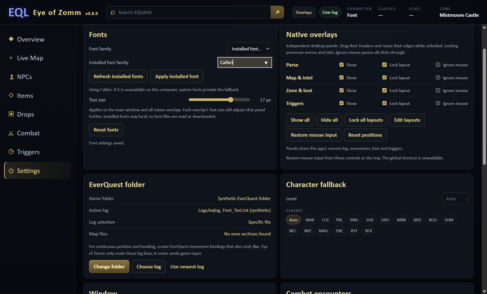

**What's new** now contains a browsable illustrated release history. Each unseen
version keeps its **New** marker until viewed, including skipped updates. New
Windows downloads start a cancellable **Restarting in 5** countdown after
verification, followed by silent installation and relaunch. Linux keeps its
verified package download and manual installation handoff.

### Maps that stay beside the game

The native Map reads your client text maps and shares the logged position, named destinations and validated route with the main app. Hover the full zone-title row for **Reset**, Follow, zoom and a button cycling **Map → Top → First person** beside its name. A separate grip moves the unlocked window. Its 3D scene loads only when used. Use Z controls to inspect another elevation; monster names and markers share interactive pointer targets. The complete main **Map Explorer** keeps its own views and zoomable Local Map.

Both 3D views mark your latest logged location with a cyan ground ring and add
a movement-direction arrow once later locations establish travel direction,
even when camera Follow is off. The marker keeps a visible minimum size when
zoomed out. In Top 3D, left drag pans; right drag rotates the perspective.
**Auto Z** uses the latest known logged elevation;
moving the Z slider or inspecting a mob switches to manual slicing. Turn Auto Z
back on, or Reset the overlay, to resume it. Missing height stays unknown. A
nearby validated floor grounds the marker; otherwise its status identifies the
logged-elevation fallback.

The native 2D map marker becomes a small arrow after two distinct logged
locations, estimating travel direction rather than actual character facing.
It holds through stationary/jitter readings and resets on zone/source changes
or a large position jump. Its background follows the overlay opacity setting;
the native 3D surface fades as a whole, including its geometry. The main map
viewer's styling remains independent.

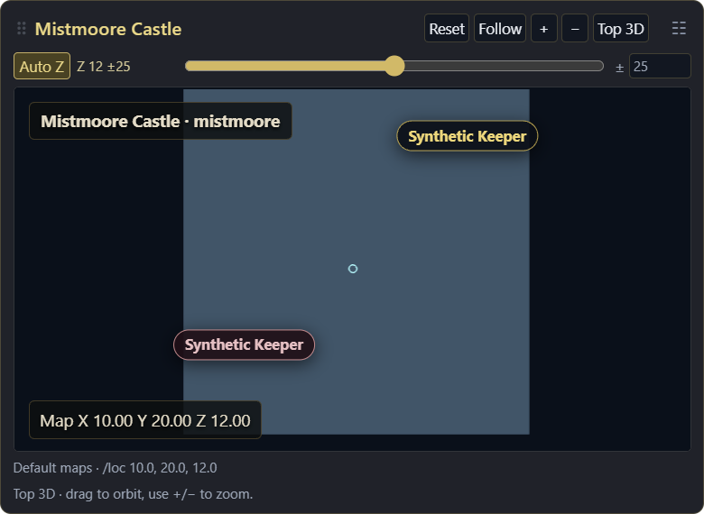

Routing is an opt-in. A line appears only after collision checks approve it; a guarded Recast/Detour candidate may refine the established route after the same checks. An unreachable or unverified destination remains a marker. Static archives do not reveal live doors or actors. [Route validation](docs/ROUTE_REJECTION_AUDIT.md) records working detours and remaining limits.

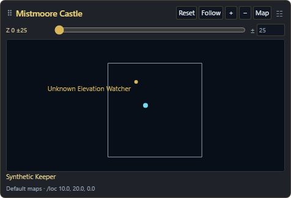

### Named mobs, raid sources and complete loot

**Zone & loot** separates Normal Zone and Raid Zone sources, with red **Raid Zone** intel shown first. Click a section heading to collapse it. **Item Level Slider** and **My Class** stay anchored above the scrolling list. Hover or keyboard-focus a mob name for Details, Route, Copy /waypoint, Wiki and Map in the same row, without moving the list. Its Map action opens a first-person preview at that source, keeping your logged position unchanged. Use **Show More** for all matching drops. Class filtering retains usable equipment/effects and excludes statless and weight-only quest/junk records. A logged consider or named kill selects and expands its row and section with a mild visual/audio cue, without activating the window.

Hover or focus an item's name or icon for its local wiki-style item card,
including tier-adjusted values, linked effects and base comparisons. Character
uses the same frame with its tier slider and Exaltation sockets; Exaltation
summaries show only name/effect. Explicit font preferences still apply.
**Through era** includes items through the chosen era. Activating a located NPC
name copies a paste-ready `/waypoint Y X [Z]`; row-level Route actions start
navigation when routing is enabled.

Routine log and location updates retain stable mob ordering, the visible row,
expanded drops and collapsed sections. A new named consider or kill still
reveals its matching row once. Plane of Hate uses Z 120 only until a known
logged elevation is available with Auto Z enabled.


The main Item and NPC browsers use the same local stat data. Item names and pictures support mouse hover and keyboard focus, including when logged activity updates a card.

Item-level-modified stats appear **green** in cards and hover blocks. Unchanged
values retain their normal color, and base comparisons stay muted. Clicking a
monster in the main **Live Map** opens its full right-hand loot pane, with every
known drop, the shared item-tier slider and explicit Route/Waypoint/Wiki actions.

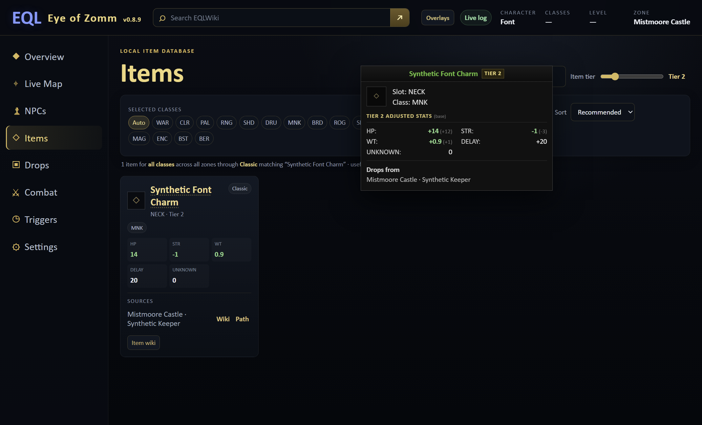

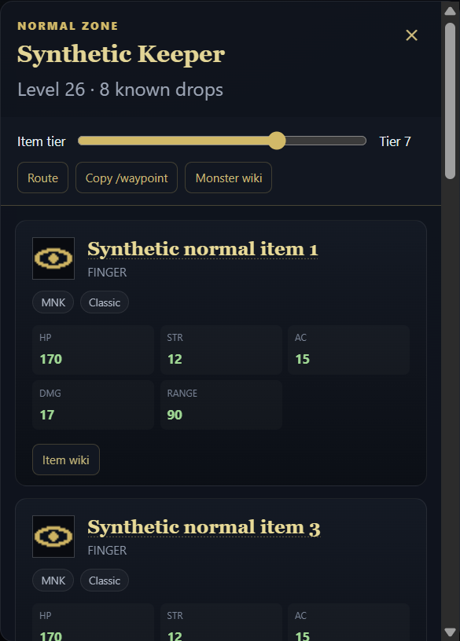

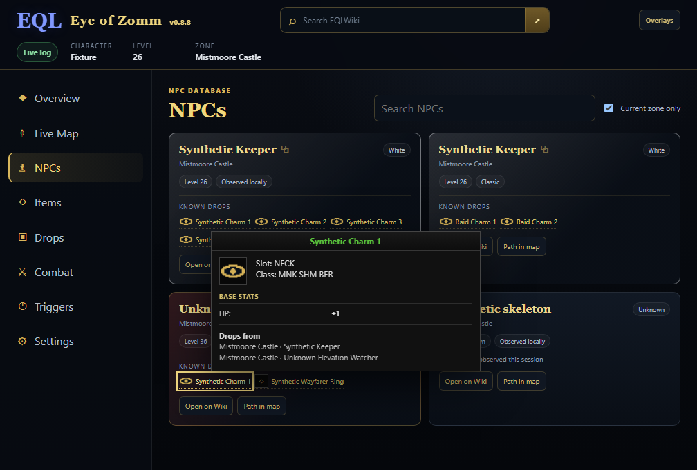

### Triggers and combat parses

Create manual countdowns or literal/regex log triggers on the main **Triggers** page. Test a match, use named captures, set cooldowns and choose local sound/speech cues. Running countdowns and an optionally enabled observed swing bar appear in the compact Triggers window. You supply reminder durations; EoZ does not know a mob's respawn period.

The independent **Parse** window has **Overview / Damage / Healing / Taken / Session** tabs and encounter selection. Healing includes a separately labeled rune-capacity subsection; capacity is not measured absorption or healing. **New session** in Combat or the Parse Session tab clears parse/loot totals while retaining the live log position, profile, map and triggers. One shared session reads the log for every panel. The optional swing bar defaults off; enable **Triggers → Swing → Show swing estimate** if desired. It estimates your outgoing melee rounds from logged hits and misses; one-second log timestamps limit its precision. See [trigger and countdown behavior](docs/TIMERS.md).

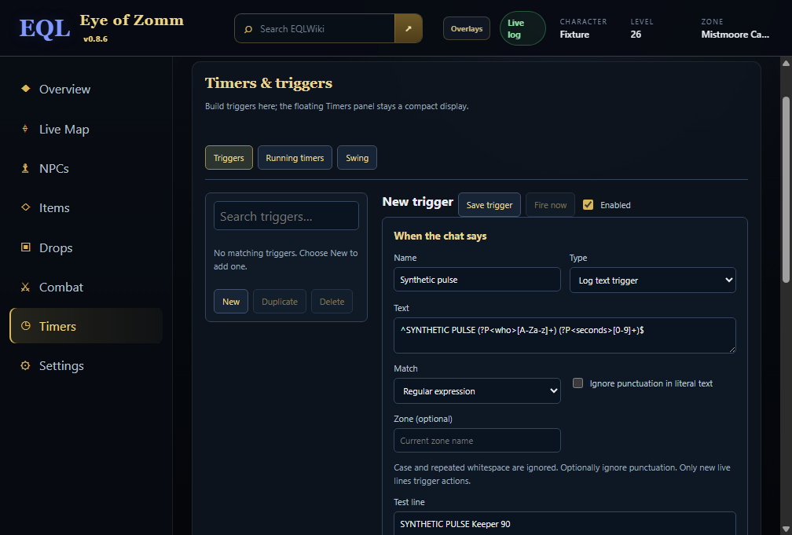

Unlock an overlay to move/resize it. Locking leaves its tabs and menus interactive; **Ignore mouse** passes clicks through. Recover from Settings, the tray, or **Ctrl+Shift+O** when registered. Layout, opacity and font scale are saved separately for each panel. Closing the main window while overlays are visible keeps their shared session running; use **Quit Eye of Zomm** in the tray to exit.

Every unlocked overlay has clear axis/diagonal resize edges and a visible corner.
Use the Parse/Map grip, Zone & loot title, or the Triggers body to drag. Dragging
immediately detaches that panel and its direct children, keeps the panel's size,
and leaves every other panel where it was. Release within 8 px of a new panel
edge to snap: above/below share width, left/right share height. The group you
just detached from cannot pull the panel back during that drag. Resizing a docked
panel still keeps its docked followers aligned and sharing the matching size.
Global Hidden suspends the group until it is shown again; hiding one panel
detaches its relations. A manual Triggers height stays saved; **Reset positions**
restores automatic content fitting. Global Unlock restores mouse input on every panel.

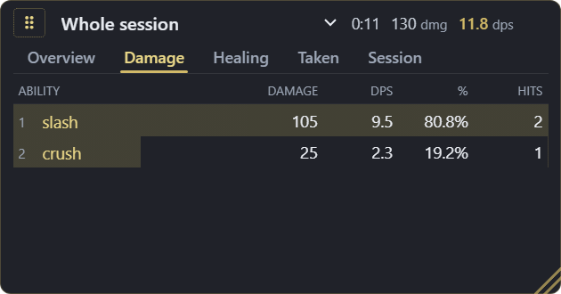

### Optional screen reading

Logs remain the source for supported kills, loot, zone and character events.
**Settings → Screen reading** adds optional local OCR for visible examine
windows and character statistics. The checkbox is a master permission, saved on
this device and disabled by default. When unchecked, native code stops active
readers and OCR, discards pending screen results, and blocks manual/automatic
Contribute reading, Character stats, source screenshots, and file/clipboard OCR.
Logs, text entry and inventory-file imports keep working. While checked, opening
**Contribute** starts item reading automatically; enabling it while Contribute is
open does the same. One recommended game window is selected automatically; an
ambiguous source requires your choice. OCR fills existing chat/log discoveries
only, including a uniquely matched small reading typo; it never creates discoveries
from screenshots alone. Pause or Stop releases
capture work; status shows which workspace owns it. **Read a screenshot** imports
one image without starting continuous capture, while the master permission is enabled.
The main app and both new tabs retain the selected fonts and text size.

Observed text and evidence remain in a bounded local journal. OCR values are
editable proposals and may be wrong or incomplete; they do not establish unseen
spawns, drop sources, caps or buffs. Starting a Character session pauses
contribution capture so the two modes cannot read the source concurrently.

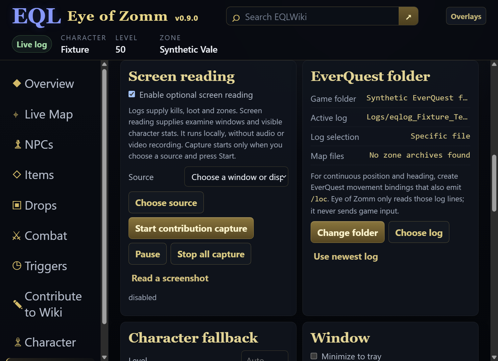

### Contribute to Wiki through an explicit review

Open **Contribute to Wiki** to review proposed items, monsters and zones from
supported live log events, screenshot reads or manual entry. Review the matched
destination page and task reason first: an existing page may need a source,
population or tier-zero correction rather than a duplicate article. A shared
resolver handles exact title aliases, apostrophes, case and supported item tiers;
an incomplete catalog cannot prove absence. Generated pet names are excluded
unless the wiki positively identifies a real NPC. Automatic monster discovery
requires kill/death evidence or a named-corpse loot source; a nearby spell cast
or consider alone does not create a new-monster task. Captured evidence shows
the triggering log line locally without adding that private text to wiki pages
or hourly observation uploads.

A fresh unknown-monster kill arms one next **/loc** and shows a noninterrupting
prompt. Stand at that monster's spawn before typing the command. A newer eligible
kill replaces the active target; older drafts remain available for explicit
rearming. Locations remain proposals for review, and EoZ never types commands.
The popup also asks `Is <monster> notable?` Choose **Yes** or **No** to save
that classification for review without opening the main window. Leaving it
unanswered preserves the location draft. The same choice is editable in
Contribute; a monster's page template does not make it notable automatically.

Encoded item links in live chat also identify missing wiki items and offer
**Contribute**; open the linked item's complete examine window. That action
starts or reuses the contribution reader, using a configured game window or
asking for an explicit source inside Contribute. An active Character capture
keeps ownership. The notice stays open until that item's fresh OCR reading is
saved, flashes green, then closes. Some clients strip link codes from logs.
For those clients, a bounded tier-decorated name in a quoted chat message can
offer a **possible item** suggestion. Ordinary unranked text and ambiguous
messages remain unsupported. Known, queued, submitted and ignored identities
still suppress repeated suggestions. Chat mentions imply no loot or drop source.

Opening **Contribute** starts gentle local reading when one safe game window
can be selected; otherwise choose the source directly in that section. Open the
selected item's complete examine window and leave it visible. Matching fresh
readings fill proposal fields and, when a reliable item crop is available, stage
a local screenshot and icon matches. Manual/reviewed fields and existing images
stay intact. Choose an icon when artwork matches are ambiguous. **Pause automatic
reading** keeps it stopped until explicitly restarted. Leaving Contribute stops
the reader it started unless an accepted discovery request still needs it;
Character and preexisting readers retain ownership. Eligible fresh new items
can publish automatically after exact, redirect and near-duplicate checks,
under the signed-in account. Only that item and its bound screenshot may be
created automatically; ambiguous/incomplete readings retain the normal review.
Loot logs can also append sources to existing item, mob and zone pages without
replacing prior sources. These updates use actual native log reads, explicit
corpse evidence or a witnessed same-zone kill within 60 seconds, and unique
confident canonical/fuzzy page matches. Ambiguous titles/conflicts stay in
Contribute. Reopening a log never publishes historical observations. Successful
creations and updates link to saved pages. See [the follow-up record](docs/CHAT_CAPTURE_FOLLOWUP_PLAN.md)
for implementation, verification and publication status.

Choosing **Contribute** on a monster prompt similarly pins it and re-arms the
next `/loc`, without a timeout while waiting. The captured location flashes the
prompt green before it closes. **×** cancels the pending request; Ignore also
removes or suppresses the suggestion. Cancelling or finishing an item request
stops only a reader started for these requests, leaving prior reader sessions
alone. Zone/log-source changes cancel an incompatible spawn request.

Correct the readable fields, choose **Raid Instance** when appropriate, and
classify observed drops as **Common Loot** or **Unique Loot**. These are wiki
sections, not measured drop probabilities. Classes and Equipment slots use
multiselect dropdowns; drop sources reuse **Zone**. Empty item fields remain
blank, while factual monster unknowns use the blueprint's supported placeholders.
The destination check and final page preview remain. Check **I reviewed these
page changes** once above Publish; there are no separate field, match or per-page
approval checkboxes.

Use the screenshot **+** area to select/paste a PNG, review its caption/license
and choose whether to publish it with the article. Local OCR is separate from
uploading. Inside **Icon ID**, paste a crop containing **just the icon** and
choose a closest artwork match, or enter the exact ID. Matching runs locally
against the wiki's versioned index; original aliases and IDs are preserved.
No icon crop uploads.

Log in through the wiki's normal dedicated window when you are ready to submit.
The app loads the current wiki blueprints, prepares a page plan and shows every
planned change. Review each page and fresh duplicate check before the final
publish action. Existing permissions and edit-conflict checks apply; a partial
result identifies unfinished pages so a retry does not repeat completed edits.
Confirmed saved pages offer **View page** links for items, monsters, zones,
spells and related updates. A monster created later through EoZ can recover
published item-source relationships into its reviewed loot list. Automatic
reverse links in wiki-rendered pages have a separate wiki deployment contract.
Nothing publishes merely because a candidate was captured or previewed.

For a tiered drop without a wiki base record, base recovery keeps the original
numbers/evidence and prefills jointly compatible editable base proposals.
Valid manual edits stay intact; unsupported numbers require correction before
review. Unknown or unsupported values stay omitted. Recovered pages carry a visible request for
verification against a tier-zero item; a genuine reviewed tier-zero reading can
replace that proposal through a scoped patch. Missing item effects can include
a separate spell-blueprint page in the same reviewed multi-page plan.

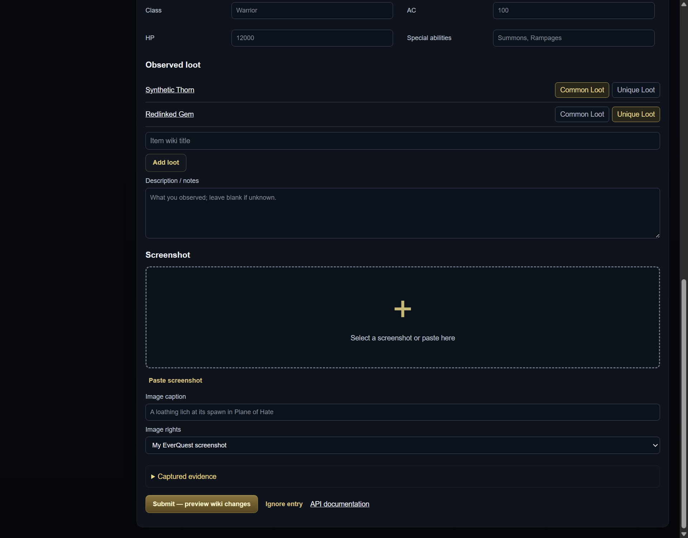

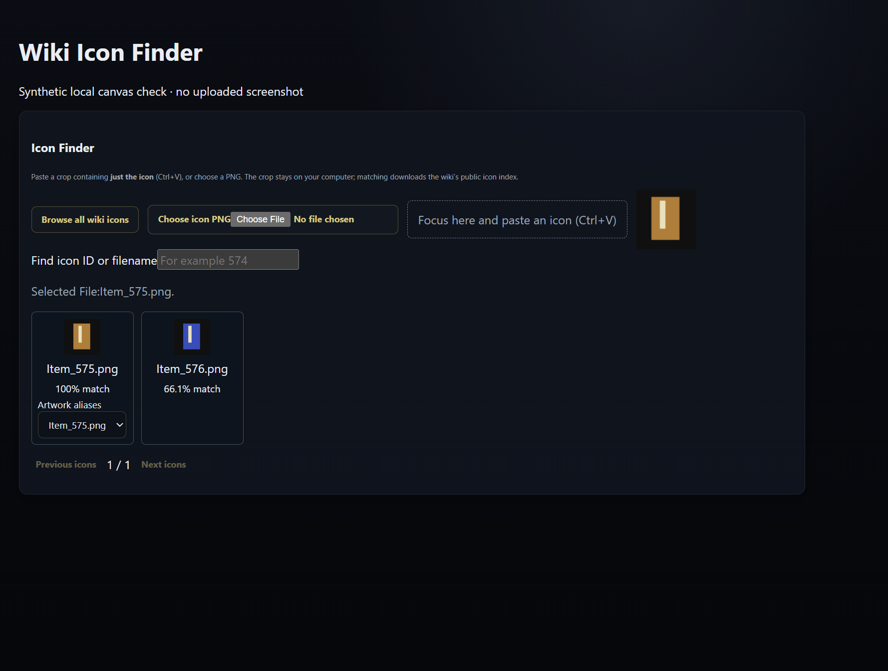

### Build and share a character snapshot

1. In **Character**, enter name, server, race, classes, level and AA count. Saved
   characters are labeled **Character (Server)**; a new draft is registered only
   after its details are valid.
2. **Keep every item equipped.** Type `/outputfile inventory` in EverQuest.
   While the inventory step is open, EoZ watches the chosen game folder for a
   fresh matching `Name_server-Inventory.txt` and imports it automatically.
   **Check now** and **Choose inventory file…** are available when needed. EoZ
   never sends the game command itself. Bags, bank and keyring entries do not
   become worn equipment.
3. **Open your Inventory. Scroll down. Click off your buffs.** Keep the whole
   Default Modern stat panel, including Additional Modifiers and the Inventory
   heading, visible. Select your game window and choose **Read character stats**.
   Review the proposal, correct uncertain values and use the reviewed stats.
   Optional screen reading runs at 1 FPS; it is not a promise to catch brief
   hover tooltips.
4. Review the inspect before copying/saving a PNG or sharing it. Totals are the
   recorded equipped, unbuffed values only, with maximum HP/Mana/Endurance,
   distinct AC and ATK components, and the observed modifiers. Accuracy bonus
   is separate from ATK Accuracy. Missing values stay unknown; changing gear,
   catalog tiers or item previews does not recalculate character totals.

Hover equipped gear to adjust its **tier directly below the name**; tier-adjusted
preview values stay green. Item cards retain real effects/procs, cast time,
required level, flags and restrictions, including Thornstinger's Rampage. None
of these previews change the recorded character totals.

Attached inventory-export **(Exaltation)** rows prefill known parent sockets. An
exact socket-only base-item alias resolves these rows without weakening worn
item matching. Unknown capacity defaults to **five**; observed capacity and
occupied positions are retained through eight. The ambiguous export Slots
column is not used as capacity.

Unknown items/Exaltations are rejected from public equipment and leave empty
slots/sockets. Use **Contribute to Wiki** to review missing item details, then
sync accepted wiki data and generate a new inventory export. Item examine OCR
belongs to Contribute, not Character gear intake. No missing item publishes
automatically. The red **Clear inventory** action affects only the selected
character's gear/import evidence and now-invalid stat reading, retaining identity
and other saved characters.

PNG copy/save stays local. Wiki sharing requires login and one explicit review;
it updates only the authenticated account's own **User page**, replacing that
Character (Server)'s managed sheet while preserving other characters and
content. Old talk-page sheets remain intact; a destination change needs a fresh
review. The app checks template/renderer support first. Raw OCR, export
paths, source IDs, private inventory and current resource counters are not
published. See [the current walkthrough](docs/CHARACTER_WALKTHROUGH.md).

The current Character flow and log-based contribution queue are browsable in
**What's new**, alongside every earlier release. These are actual component
captures with synthetic records and an isolated profile.

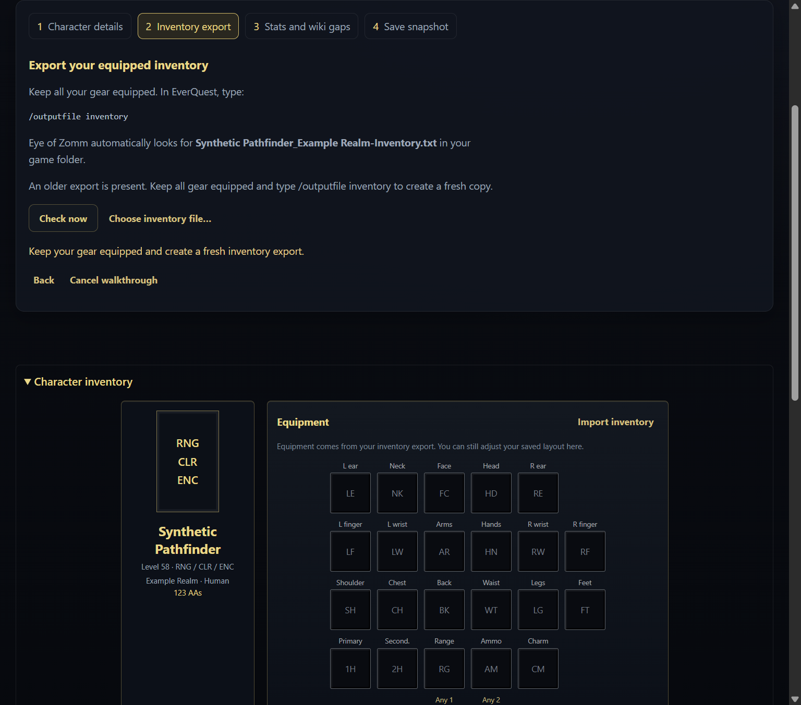
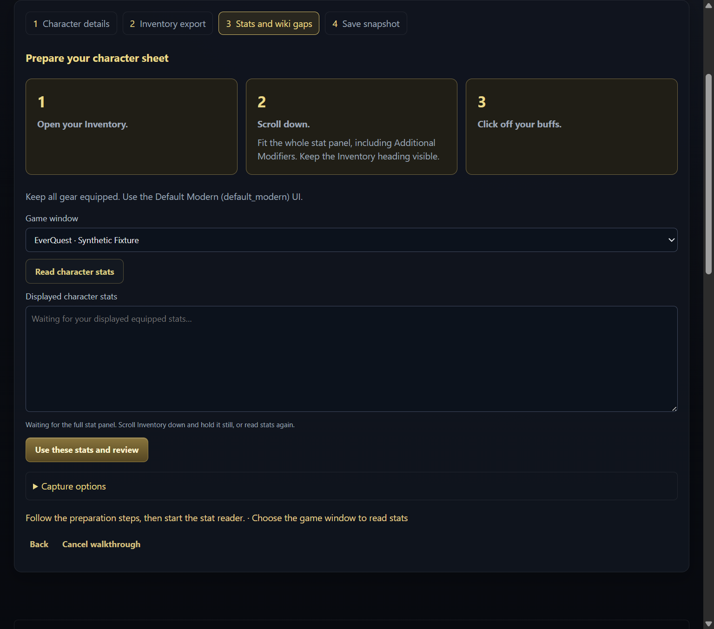
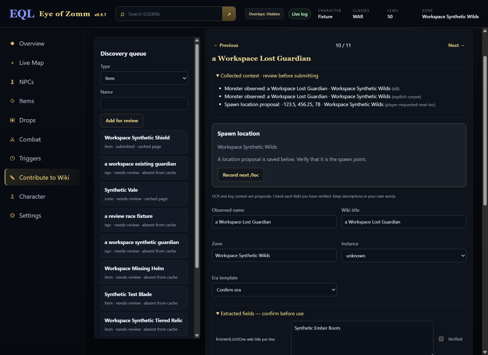

## Local files and optional wiki sync

EoZ reads logs and supported map/archive files under the folder you choose.
Optional screen reading reads only the source you select;
it does not record audio or continuous video. EoZ never reads game-process memory,
injects code, patches game files, sends game commands or synthesizes gameplay
input. Wiki edits/uploads require the review actions described above. See
[SAFETY.md](SAFETY.md).

Wiki discovery notices appear in a separate bottom-right popup for 15 seconds of visible time. Local catalog checks run first; possible missing items require a live exact-title check before a notice appears. **Contribute** opens item capture; **Screenshot** copies a chosen window or display to your clipboard. Active capture keeps its notice available, then shows its confirmation for 15 seconds. Unanswered notices pause while hovered or keyboard-focused.

Global **Search EQLWiki** opens a wiki search in your browser. Item/NPC cards open their exact wiki pages. Ordinary search and filtering use cached data and do not crawl wiki pages.

**Settings → Collect and sync drop observations** controls a separate durable
outbox. While enabled, fresh kill/loot events are saved locally even for known
or ignored wiki entities. While the app is running and you are logged in, due
batches are sent at most hourly to the wiki, with overdue startup checks and
retry backoff. Offline events survive restarts; parse resets and Contribute
Ignore/clear actions do not erase them. Disable the setting to stop collection
and upload while retaining pending data.

Only structured item/NPC/zone/source/tier/quantity/time evidence is sent, with
opaque deduplication tokens. Player names, chat, paths, coordinates, screenshots
and raw logs are excluded. Accepted observations are separate from reviewed
article edits and do not imply drop chances or zero-drop counts. Other tools
can use the documented attributed MediaWiki create/edit/upload APIs and the
versioned observation endpoint: [API documentation](https://eqlwiki.com/API_Documentation).
The observation endpoint/storage version 1.2.0 and public documentation are
installed for 0.9.8. Future schema, database-page and application deployments
still have separate activation and verification steps.

## Two separate updates

| Update | What it changes | Where to use it |
| --- | --- | --- |
| Application update | Installed EoZ code and interface | **Settings → Application updates**: check/download; Windows counts down to restart, Linux offers **Open download folder** |
| Wiki data update | Cached NPCs, items, icons, zone aliases and source records | **Sync with Wiki**, also checked at startup and hourly while open |

From 0.8.9, a new verified Windows download shows **Restarting in 5** and silently installs and relaunches automatically. Choose **Cancel restart** to keep the staged package for later, then use **Restart to install update** when ready. Merely reopening EoZ with a previously staged package does not start a countdown. Startup downloading is optional and off by default; when enabled, a newly completed startup download also starts the countdown. Windows may still require a security or elevation prompt. Settings, folder/log choices and cached wiki data stay in the existing profile. Older installed builds use their existing installer flow for the first upgrade.

On Linux, **Open download folder** reveals the verified AppImage/deb with manual
installation instructions. Close EoZ, replace the AppImage or install the deb,
then reopen it. Linux updates do not run the Windows installer or claim an
automatic restart; the saved profile remains in the native application-data
location.

The wiki data flow is server-side and low priority:

```text
EQLWiki content → local exporter → gzip + SHA-256 manifest
               → GitHub dataset branch → verified local cache
```

Official installers include a production snapshot, so first launch does not reconstruct the wiki corpus. Startup, hourly background checks and **Sync with Wiki** check the small GitHub manifest; a changed version downloads and verifies the pack before replacing the cache. Overlapping requests share one check, and failure keeps the last valid data. Settings separates the last check, successful check, dataset generation, download and next check times. Players do not poll EQLWiki for dataset updates.

The producer reads production MediaWiki's local content/database services and builds zone aliases, NPC locations/provenance, normal/raid source variants, items and embedded icons. Hourly host eligibility checks rebuild after 24 hours since the last successful publication; manual refresh remains available. Only the filtered manifest and compressed pack reach the dedicated `dataset` branch. Staging's private database copies use the same 24-hour freshness guard and separate hourly eligibility checks. Installing producer changes and rebuilding the dataset are separate from a desktop release; see [server operations](server/README.md).

## Development and validation

Node.js 22+ is required. Normal development works on Windows, macOS or Linux;
release packages target Windows x64 and Linux x64. See the
[platform/release guide](docs/FONTS_LINUX.md) for CI evidence and remaining
desktop/game acceptance.

```bash
npm ci
npm test
npm start
```

Fetch the verified production bootstrap before catalog checks or packaging:

```bash
node scripts/fetch-bootstrap-pack.mjs --required
npm run test:catalog
npm run test:desktop-worker
npm run dist:win
npm run test:artifact
```

Linux packaging uses `npm run dist:linux`; the GitHub build performs native
Linux packaged-executable checks under Xvfb. One publisher waits for both
platform builds and their shared verified bootstrap before creating the release.

Screenshots can be reproduced from the real Electron synthetic fixture without opening an actual game installation:

```bash
node scripts/test-native-overlays.mjs --screenshots <output-directory>
node scripts/test-capture-workspace.mjs --screenshots <output-directory>
```

Tests with synthetic content do not establish live route quality, physical overlay focus/passthrough, monitor/DPI transitions or installer acceptance. Keep client archives, player logs, database snapshots, settings, generated packs and private diagnostic exports out of Git.

### Developing the wiki integration

Start with [EQLWiki's developer repository](https://github.com/Maergoth/EQLWiki)
and the public [API documentation](https://eqlwiki.com/API_Documentation).
EoZ uses the same attributed MediaWiki APIs available to other clients; it has
no private edit proxy or shared bot identity. The desktop app opens the normal
wiki login in a dedicated persistent session. Cookies and CSRF tokens stay in
the trusted native service, and wiki IPC admits only the exact main frame.

| Boundary | Entry points | Contract |
| --- | --- | --- |
| Desktop / renderer | [main](desktop/main.cjs), [preload](desktop/preload.cjs), [app](app/app.js) | Main owns private files, wiki transport and native windows; preload exposes bounded actions; the renderer owns the shared log/UI session. |
| Auth and API transport | [WikiHost](desktop/wiki-host.cjs), [WikiClient](desktop/wiki-client.cjs) | Fixed wiki origin/session, current-account assertions, bounded requests and tokens kept outside renderer/draft state. |
| Reviewed contributions | [workspace](app/capture-workspace.js), [draft builder](app/contribution-model.js), [queue](app/contribution-queue.js) | Resolve identity/task reasons, load current Help blueprints, preview every page, then publish scoped changes with revision/create-only guards and persisted partial retry. |
| Character sharing | [model](app/character-model.js), [totals](app/character-totals.js), [sheet serializer](app/character-wiki-sheet.js) | Import known gear separately from confirmed recorded totals; share only a bounded managed Character (Server) block on the authenticated User page. |
| Observation sync | [collector](app/drop-observations.js), [storage](desktop/drop-observation-storage.cjs), [sender](desktop/drop-observation-host.cjs) | Separate minimal schema-1 kill/loot outbox, stable IDs, account-bound receipts and due hourly batches; no article edits or raw-log upload. |
| Published wiki data | [producer/host contract](server/README.md), [bootstrap fetch](scripts/fetch-bootstrap-pack.mjs), [client cache](desktop/main.cjs) | Wiki-local export → filtered GitHub `dataset` manifest/gzip → SHA-256-verified bootstrap/cache. Dataset refresh, observation ingestion and application releases are separate operations. |

For a new integration, read account/source/revision context with `action=query`,
load the documented current blueprints, and render an unsaved `action=parse`
preview. Submit `action=edit` with the user's CSRF/account assertions plus
`createonly` for new pages or `nocreate`/`baserevid` for patches. Screenshots use
explicit reviewed `action=upload`; reconcile uncertain results before retrying.
The separate `action=eozobservations` endpoint uses a versioned bounded batch
and exhaustive per-event acknowledgements, not the article-edit workflow.

Use [the contribution design](docs/design/WIKI_CONTRIBUTIONS.md),
[persistent contribution ignores](docs/CONTRIBUTION_IGNORES.md),
[evidence/outbox contract](docs/CONTRIBUTION_EVIDENCE_PLAN.md),
[Character walkthrough](docs/CHARACTER_WALKTHROUGH.md) and
[current release plan](docs/RELEASE_098_PLAN.md) for the detailed boundaries.
Focused checks include `node tests/wiki-client.mjs`,
`node tests/wiki-observations.mjs`, `node tests/drop-observations.mjs` and
`npm run test:capture-workspace`; use disposable profiles and loopback wiki
fixtures for writes. Run the full/platform/package gates for a release.
Wiki PRs target `staging`; promote only scoped reviewed changes. File deployment
does not publish database templates/scripts, install schema/private host jobs or
refresh the dataset. See the wiki repository's contributor/operations guides
before changing either side of that contract.

| Documentation | Purpose |
| --- | --- |
| [Contributor handoff](docs/HANDOFF.md) and [implementation status](docs/IMPLEMENTATION_STATUS.md) | Architecture, source ownership and exact next work |
| [0.9.10 release record](docs/RELEASE_0910_PLAN.md), [discovery](docs/CONTRIBUTION_DISCOVERY_PLAN.md) and [item forms](docs/CONTRIBUTION_ITEM_FORM_PLAN.md) | Current request/evidence lifecycle, simpler review, component source map and separate app/wiki publication gates |
| [Product vision](docs/UX_VISION.md) and [PNUT interaction plan](docs/PNUT_UX_PLAN.md) | UX contracts and feature scope |
| [Window/map follow-up](docs/WINDOW_MAP_POLISH.md) | Current window, map and tour changes |
| [0.9.0 capture/contribution status](docs/CAPTURE_CONTRIBUTIONS.md) | Feature scope, ownership and acceptance contracts |
| [0.9.0 release verification](docs/RELEASE_090.md) | Authorized release checks, platform evidence and publication ledger |
| [Guided Character and overlay release](docs/CHARACTER_WALKTHROUGH.md) | Current flow, component ownership, native acceptance and 0.9.1 publication gates |
| [Capture pipeline](docs/design/CAPTURE_PIPELINE.md), [wiki contribution contract](docs/design/WIKI_CONTRIBUTIONS.md) and [character/share contract](docs/design/CHARACTER_CAPTURE.md) | Local observation, reviewed write and independent stat/equipment semantics |
| [Map validation](docs/MAP_VALIDATION.md) and [destination-only audit](docs/ROUTE_REJECTION_AUDIT.md) | Real local-archive observations and limits |
| [Navigation architecture](docs/NAVMESH_EVALUATION.md) | Guarded worker routing and independent collision validation |
| [Validation report](VALIDATION.md) and [Windows checklist](docs/WINDOWS_MANUAL_TEST.md) | Automated gates and remaining manual acceptance |
| [Contributing](CONTRIBUTING.md), [security](SECURITY.md) and [signing](SIGNING.md) | Contribution and release boundaries |
| [Overlay and item-form follow-ups](docs/OVERLAY_DRAG_DETACH_PLAN.md), [shared wiki item cards](docs/WIKI_ITEM_HOVERS_PLAN.md) | Next-release scope, source/native evidence, pending PR integration and remaining installer gates. |

The main source areas are `app/` (UI, parsing, maps and local knowledge), `desktop/` (Electron, overlays and file bridge), `server/` (wiki export), `scripts/` (build/validation), `tests/` and `wiki/` (optional launcher integration).

Eye of Zomm is [MIT licensed](LICENSE). Zone Viewer, Recast/Detour and PNUT notices remain under `THIRD_PARTY/`.

NPC `zone = Various` is retained in the dataset as a scoped all-zones marker.
Normal population uses the zone’s existing DynamicZoneList, which selects NPC
pages in both the zone category and `NPCs`; missing membership adds the NPC
category source. Only a player’s confirmed Notable choice adds a manual Notable
NPCs summary entry. Automatic zone Unique Items additions retain the global
fewer-than-six-monsters rule, require actual gear statistics beyond weight, and
use only a pre-existing Unique Items row in the selected normal/raid scope.
Zones such as Plane of Sky without that row are skipped.

The 0.9.9 presentation layer is in `app/contribution-presentation.js` (queue
categories, filters and order), `app/contribution-update.js` (specific gap fields
and addition summaries), and `app/contribution-editor.js` (destination cards and
form markup). `desktop/wiki-client.cjs` independently builds canonical reciprocal
item/monster/zone edits; it never trusts a UI summary as authorization. Unsupported
existing page layouts need manual resolution instead of destructive reformatting.
`npm run test:workspace-099` exercises the real component with isolated synthetic
records, including pointer timing, filters, focused tier changes and slot badges.
