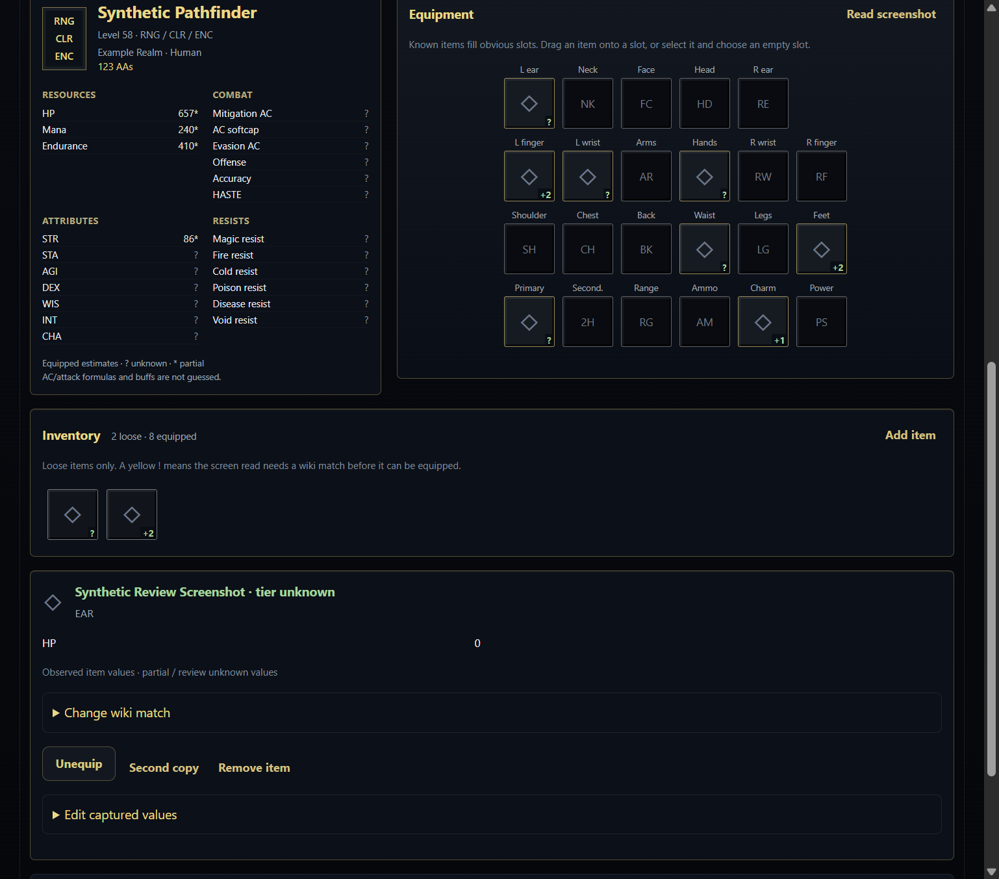
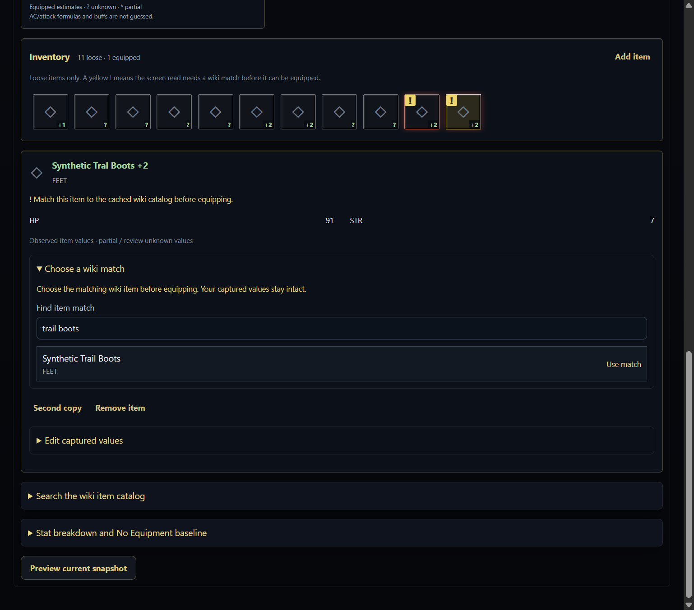
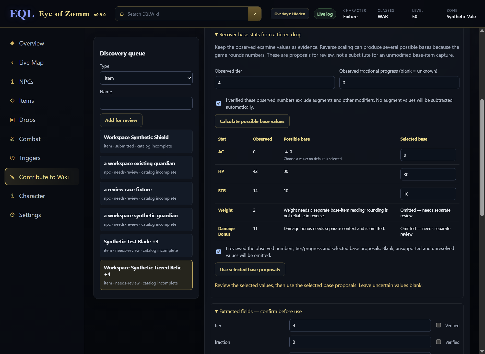
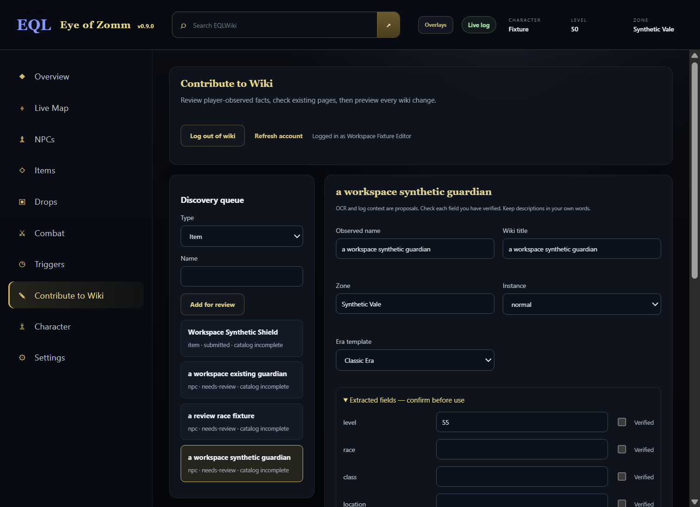
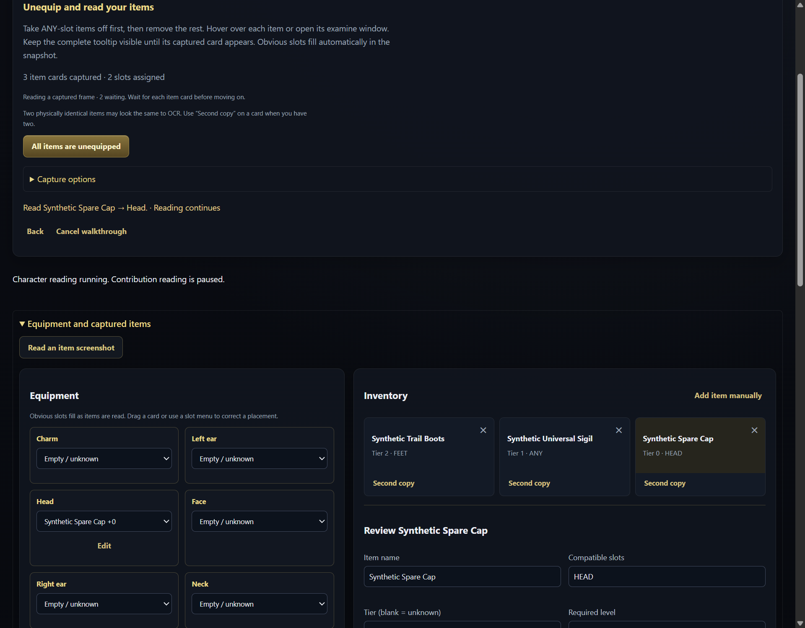
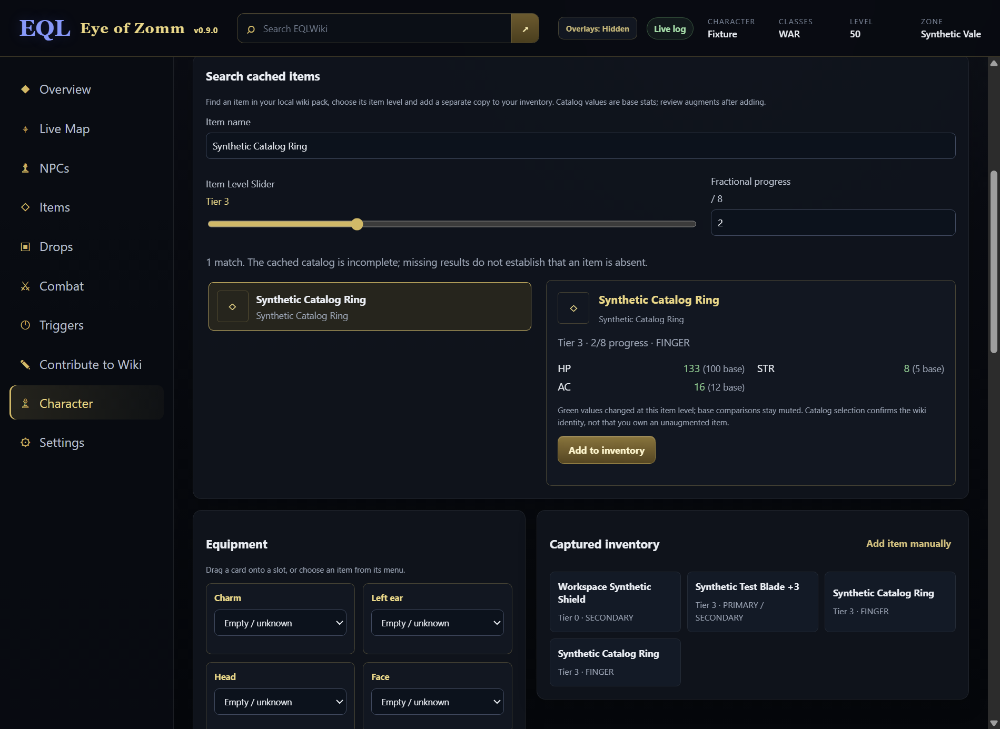
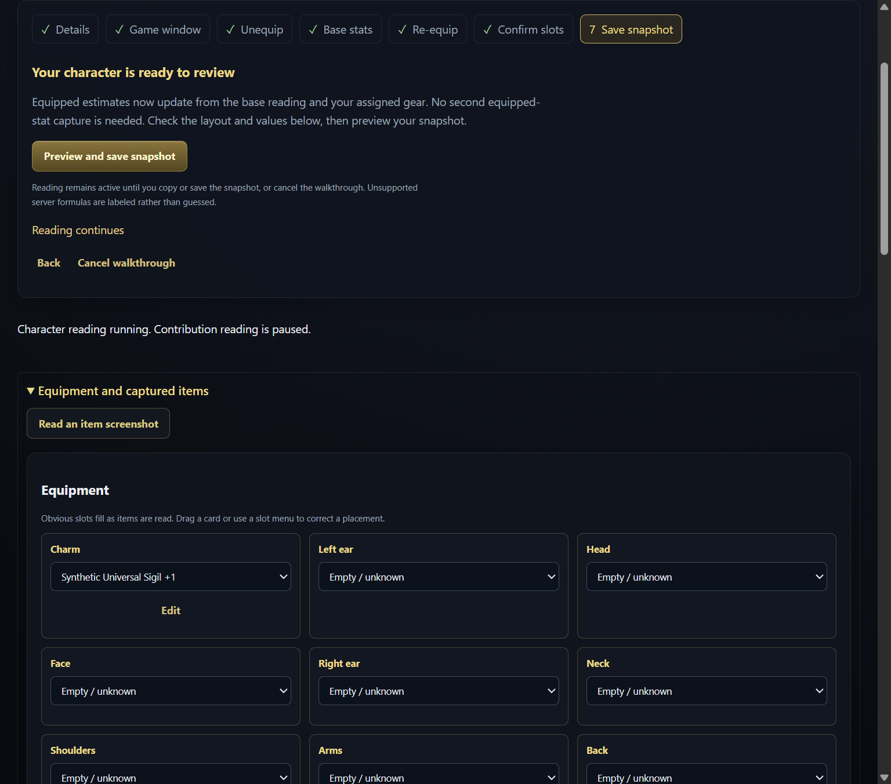
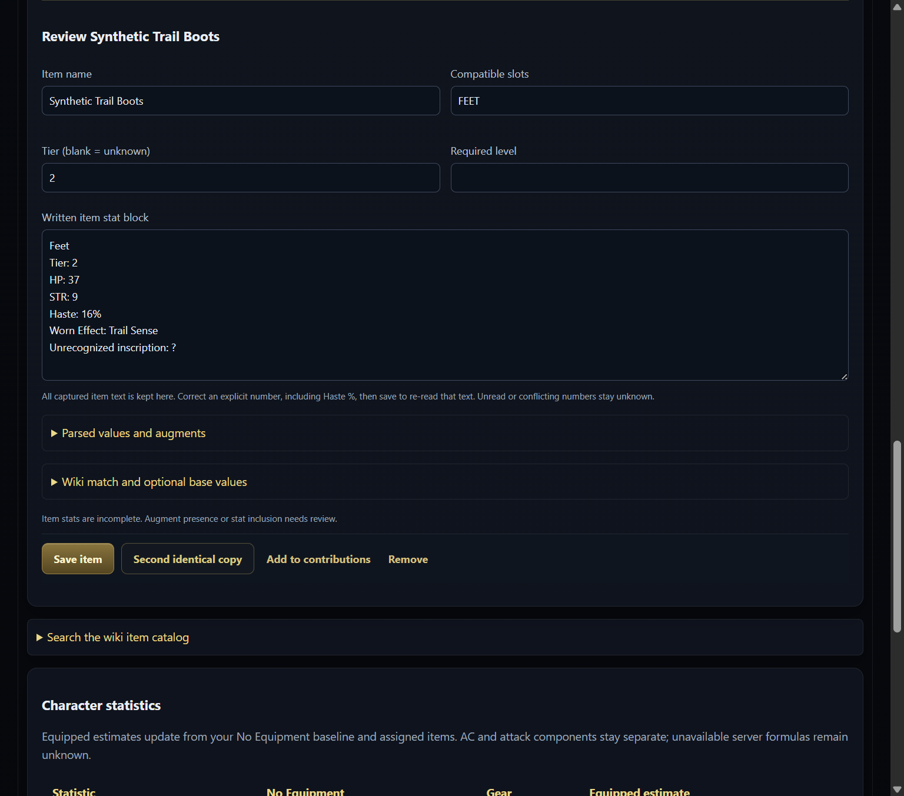
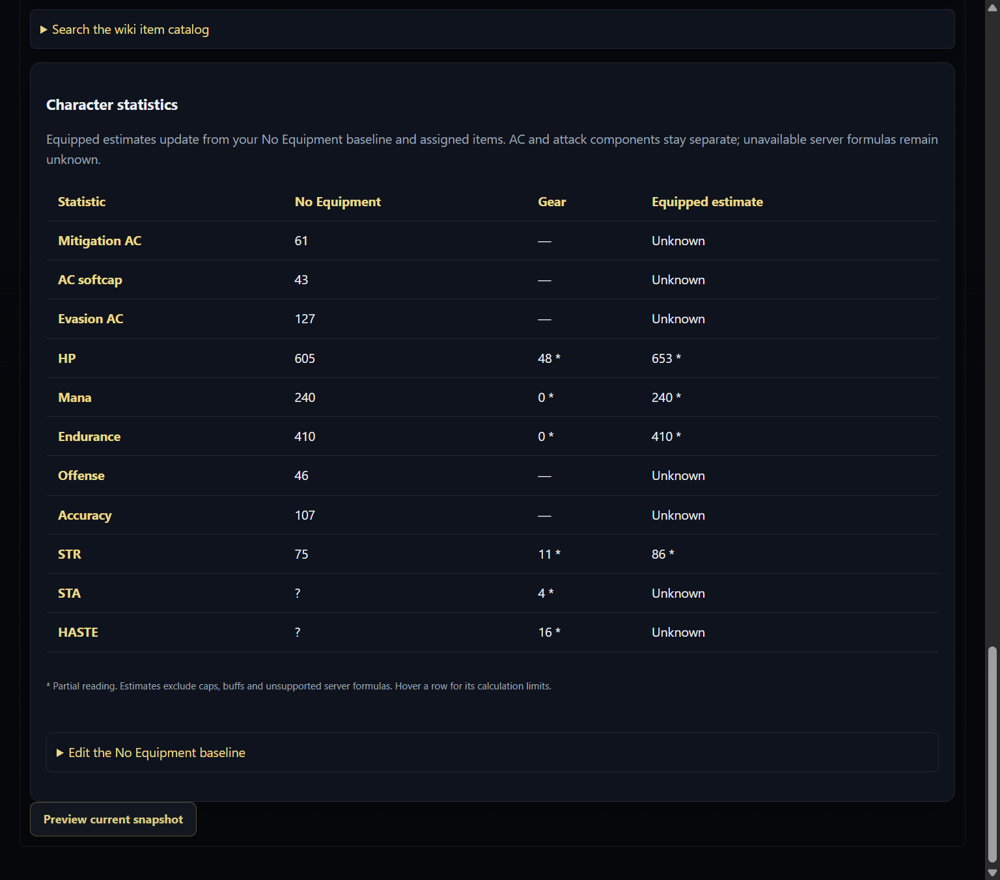

# EQLWiki — Eye of Zomm

**Eye of Zomm** is a local-first Windows and Linux app for **EverQuest Legends**. It reads ordinary game logs, combines them with cached EQLWiki knowledge, and keeps maps, named-mob loot, combat parses and triggers in separate desktop windows.

[Download Windows / Linux](https://github.com/Maergoth/EQL-EOZ/releases) · [EQLWiki](https://eqlwiki.com) · [Report an issue](https://github.com/Maergoth/EQL-EOZ/issues) · [Changelog](CHANGELOG.md)

**0.9.4 gives Character a compact MMO inventory.** Identity and equipped
estimates sit beside 23 icon slots; equipped physical items leave loose
inventory. Bounded OCR spelling corrections use the cached wiki catalog, and
unmatched reads stay highlighted until you choose a match. Item tiers display
once while original observations remain available for review.

Unequip slowly, one item at a time. Keep each complete Default Modern tooltip
visible until its card appears. Reading continues through slot and snapshot
review; capture ends when you finish or cancel. See the
[inventory review plan](docs/CHARACTER_INVENTORY_REVIEW.md),
[live capture recovery plan](docs/LIVE_CAPTURE_RECOVERY.md) and
[guided walkthrough](docs/CHARACTER_WALKTHROUGH.md).





In **Settings → Screen reading**, start an explicitly selected source. Optionally use
**Calibrate OCR area** to draw around a complete examine or Inventory/stat pane.
Screen reading currently requires the **Default Modern (`default_modern`)
game UI skin**. Other skins remain unverified until their layouts are supported.
Ordinary log parsing works independently of the game UI skin.
Keyboard percentage fields and **Full frame** are available too. Areas are saved
per source and capture mode and reset if the frame size changes. OCR proposes
editable fields; unresolved values remain unknown.


## Get started

1. Download the latest Windows `Setup-<version>-x64.exe`, Linux `<version>-x64.AppImage`, or Debian/Ubuntu `<version>-x64.deb` package from [Releases](https://github.com/Maergoth/EQL-EOZ/releases). Both platforms use the same version and data source.
2. Choose your EverQuest Legends folder on first launch. Enable logging in the game; EoZ follows the newest `eqlog_*.txt` under `Logs`, or a specific file selected in Settings.
3. Emit `/who` to establish your character's zone, level and classes, and `/loc` to place your position on the map. Later logged locations update it automatically.
4. The header **Overlays** button cycles all panels through **Unlocked → Locked → Hidden → Unlocked**. Unlock to arrange Parse, Map, Zone & loot and Triggers, or configure each in **Settings → Native overlays**. Reopen **Settings → About Eye of Zomm → What's new** for the illustrated tour.

The Windows installer creates normal Start Menu/Desktop shortcuts and registers `eqleoz://` so EQLWiki can open the app. Beta installers may be unsigned and show a Windows publisher prompt; see [signing status](SIGNING.md). Linux package and compositor details are in the [font/Linux guide](docs/FONTS_LINUX.md).

Share the same [Releases link](https://github.com/Maergoth/EQL-EOZ/releases) with
Windows and Linux users. Each release contains every platform package under one
version; no separate Linux branch, release schedule or wiki dataset is needed.

On Linux, make the AppImage executable and launch it, or install the deb using your distribution's package installer. Choose the actual client directory inside your Wine/Proton prefix or mounted installation; EoZ reads that directory's ordinary logs and map files. It runs as a separate native desktop app. X11/XWayland is preferred for independently positioned overlays; [native Wayland limits](https://www.electronjs.org/docs/latest/api/browser-window) can affect placement, focus and topmost behavior.

## A look around

The inventory images show the actual **0.9.4 Character component with synthetic records**. The tooltip-reading image shows the actual **0.9.2 Character component with synthetic records and capture status**; other guided Character images show 0.9.1. Capture and contribution images show 0.9.0 with a loopback-only wiki; font, green-stat and loot-pane images show 0.8.9. Older map/trigger captures show 0.8.8, archived from [Windows CI](https://github.com/Maergoth/EQL-EOZ/actions/runs/39863077085) and [Linux/X11 CI](https://github.com/Maergoth/EQL-EOZ/actions/runs/39862385659/job/120116045766). They contain no player records, proprietary geometry or live game capture. Foreground game compositing and OS-wide DPI still require [Windows acceptance checks](docs/WINDOWS_MANUAL_TEST.md).

### A normal desktop workspace

Move and resize the main window normally. Its size, position and maximized state are remembered, with recovery when a display is unavailable. **Minimize to tray** and **Start minimized** are optional Settings choices. When the tray is unavailable, minimizing keeps the normal taskbar recovery path. The main window has no Pin to top mode; overlays retain their own lock and mouse controls.

**Settings → Fonts** selects a font family and base **Text size** from 10–20 px.
The choice applies immediately to the main app and native overlays and survives
restart. Each overlay retains its own text adjustment on top of that base.
For a font outside the presets, choose **Installed font…**, **Refresh installed
fonts**, search its family name and **Apply installed font**. You can also enter
an installed family manually. Missing families use local system fallbacks.
**Reset fonts** restores the EQL theme/13 px. Upgrades clear old cached interface
files so newly added Settings appear immediately.


**What's new** now contains a browsable illustrated release history. Each unseen
version keeps its **New** marker until viewed, including skipped updates. New
Windows downloads start a cancellable **Restarting in 5** countdown after
verification, followed by silent installation and relaunch. Linux keeps its
verified package download and manual installation handoff.

### Maps that stay beside the game

The native Map reads your client text maps and shares the logged position, named destinations and validated route with the main app. Hover the full zone-title row for **Reset**, Follow, zoom and a button cycling **Map → Top → First person** beside its name. A separate grip moves the unlocked window. Its 3D scene loads only when used. Use Z controls to inspect another elevation; monster names and markers share interactive pointer targets. The complete main **Map Explorer** keeps its own views and zoomable Local Map.

Both 3D views mark your latest logged location with a cyan ground ring, even
when camera Follow is off. **Auto Z** uses the latest known logged elevation;
moving the Z slider or inspecting a mob switches to manual slicing. Turn Auto Z
back on, or Reset the overlay, to resume it. Missing height stays unknown. A
nearby validated floor grounds the marker; otherwise its status identifies the
logged-elevation fallback.


Routing is an opt-in. A line appears only after collision checks approve it; a guarded Recast/Detour candidate may refine the established route after the same checks. An unreachable or unverified destination remains a marker. Static archives do not reveal live doors or actors. [Route validation](docs/ROUTE_REJECTION_AUDIT.md) records working detours and remaining limits.


### Named mobs, raid sources and complete loot

**Zone & loot** separates Normal Zone and Raid Zone sources, with red **Raid Zone** intel shown first. Click a section heading to collapse it. **Item Level Slider** and **My Class** stay anchored above the scrolling list. Hover or keyboard-focus a mob name for Details, Route, Copy /waypoint, Wiki and Map in the same row, without moving the list. Its Map action opens a first-person preview at that source, keeping your logged position unchanged. Use **Show More** for all matching drops. Class filtering retains usable equipment/effects and excludes statless and weight-only quest/junk records. A logged consider or named kill selects and expands its row and section with a mild visual/audio cue, without activating the window.

Hover or focus an item's name or icon for its local stat block, including tier-adjusted values and base comparisons. **Through era** includes items through the chosen era. Activating a located NPC name copies a paste-ready `/waypoint Y X [Z]`; row-level Route actions start navigation when routing is enabled.

Routine log and location updates retain stable mob ordering, the visible row,
expanded drops and collapsed sections. A new named consider or kill still
reveals its matching row once. Plane of Hate uses Z 120 only until a known
logged elevation is available with Auto Z enabled.


The main Item and NPC browsers use the same local stat data. Item names and pictures support mouse hover and keyboard focus, including when logged activity updates a card.

Item-level-modified stats appear **green** in cards and hover blocks. Unchanged
values retain their normal color, and base comparisons stay muted. Clicking a
monster in the main **Live Map** opens its full right-hand loot pane, with every
known drop, the shared item-tier slider and explicit Route/Waypoint/Wiki actions.


### Triggers and combat parses

Create manual countdowns or literal/regex log triggers on the main **Triggers** page. Test a match, use named captures, set cooldowns and choose local sound/speech cues. Running countdowns and an optionally enabled observed swing bar appear in the compact Triggers window. You supply reminder durations; EoZ does not know a mob's respawn period.

The independent **Parse** window has **Overview / Damage / Healing / Taken / Session** tabs and encounter selection. Healing includes a separately labeled rune-capacity subsection; capacity is not measured absorption or healing. **New session** in Combat or the Parse Session tab clears parse/loot totals while retaining the live log position, profile, map and triggers. One shared session reads the log for every panel. The optional swing bar defaults off; enable **Triggers → Swing → Show swing estimate** if desired. It estimates your outgoing melee rounds from logged hits and misses; one-second log timestamps limit its precision. See [trigger and countdown behavior](docs/TIMERS.md).


Unlock an overlay to move/resize it. Locking leaves its tabs and menus interactive; **Ignore mouse** passes clicks through. Recover from Settings, the tray, or **Ctrl+Shift+O** when registered. Layout, opacity and font scale are saved separately for each panel. Closing the main window while overlays are visible keeps their shared session running; use **Quit Eye of Zomm** in the tray to exit.

Every unlocked overlay has clear axis/diagonal resize edges and a visible corner.
Move any panel until it touches another: above/below share width, left/right
share height. Saved dock chains follow target movement and resizing. Drag away
to detach. Global Hidden suspends the group until it is shown again; hiding one
panel detaches its relations. A manual Triggers height stays saved; **Reset positions** restores
automatic content fitting. Global Unlock restores mouse input on every panel.


### Optional screen reading

Logs remain the source for supported kills, loot, zone and character events.
**Settings → Screen reading** adds optional local OCR for visible examine
windows and character statistics. Enable the controls, choose a window or
display, then press **Start contribution capture**. Pause or Stop releases
capture work; status shows which workspace owns it. **Read a screenshot** imports
one image without starting continuous capture. Screen reading starts disabled.
The main app and both new tabs retain the selected fonts and text size.

Observed text and evidence remain in a bounded local journal. OCR values are
editable proposals and may be wrong or incomplete; they do not establish unseen
spawns, drop sources, caps or buffs. Starting a Character session pauses
contribution capture so the two modes cannot read the source concurrently.


### Contribute to Wiki through an explicit review

Open **Contribute to Wiki** to review proposed items, monsters and zones from
supported live log events, screenshot reads or manual entry. Correct the fields,
verify what you observed and check potential existing pages. An incomplete or
unavailable catalog does not prove a page is missing. Keep descriptions in your
own words and confirm proposed loot/location relationships separately.

Log in through the wiki's normal dedicated window when you are ready to submit.
The app loads the current wiki blueprints, prepares a page plan and shows every
planned change. Review each page and fresh duplicate check before the final
publish action. Existing permissions and edit-conflict checks apply; a partial
result identifies unfinished pages so a retry does not repeat completed edits.
Nothing publishes merely because a candidate was captured or previewed.

For a tiered drop without a wiki base record, **Recover base stats from a tiered
drop** keeps the observed numbers and evidence intact. Verify exact tier,
progress and absence of augments/modifiers, then calculate possible bases.
Choose among rounded ranges yourself; blank, unsupported and unresolved values
are omitted. Applying a proposal still requires verifying the outgoing stat
text. The wiki preview labels the result as an inference. Editing its source,
assumptions or selected values invalidates that review.





### Build and share a character snapshot

In **Character**, enter name, server, classes, level and AA count, then start the
walkthrough. Select the game window inline; Default Modern is the calibrated
skin. Remove ANY-slot equipment first and show each item's hover tooltip or
examine window while unequipping. Obvious slots fill automatically. Keep each
item visible until its card appears; if reading is catching up, pause on the
next tooltip rather than moving through more items. Reading remains local and
temporary frame queuing is bounded. Use Second copy for two physically
identical items. Each inventory card has a
top-right × to remove it. Read an item screenshot and manual cards remain in
Equipment and captured items.



After confirming all equipment is off, review one fresh **No Equipment** block.
Mitigation AC, AC softcap, evasion AC, offense and accuracy are separate values.
Manual corrections survive later OCR reads. Re-equip ordinary items first and
ANY items last, examine anything missed, then confirm ambiguous slots together.
Source loss offers Resume or Choose game window without losing the current step.

**Search for item** uses the cached wiki catalog. Select an item and preview its
tier/progress with changed values in green, then **Add to inventory**. Repeated
adds create distinct copies. Catalog bases stay separate from observed examine
stats; unknown augment state and unsupported adjustments remain explicit.





Augments retain their own names and observed statistics. State whether the
examine block already includes them so their values are not added twice.
Equipped estimates update from the reviewed baseline and assigned gear; a second
equipped-stat capture is unnecessary. Additive estimates exclude caps and buffs.
AC/ATK component conversions and exact Haste stacking remain unknown where the
server formula is unavailable. The written item block retains unparsed text;
correct an explicit Haste percentage and Save item to reparse it.



Use **Preview and save snapshot**, review the entire PNG, then copy or save it locally.
Successful copy/save completes the walkthrough and ends Character reading;
canceling Save keeps reading. Explicit Cancel walkthrough is always available.
The image contains assigned gear, base values, calculated estimates and
uncertainty; raw OCR evidence and unassigned inventory are excluded. Optional
authenticated upload requires an additional confirmation and targets only your
own user talk page. Upload and talk-page results are reported separately.



These captures and local checks use synthetic records. The combined UI fixture
exercises real local OCR import, disposable PNG save/clipboard handling and
guarded writes to a loopback wiki. It does not establish live-game OCR accuracy,
production login/edit/upload acceptance, foreground game composition or native
Wayland behavior. The [current release plan](docs/CHARACTER_WALKTHROUGH.md) records
the checked platforms and remaining manual acceptance limits.

## Your files stay local

EoZ reads logs and supported map/archive files under the folder you choose.
Optional screen reading reads only the source you select;
it does not record audio or continuous video. EoZ never reads game-process memory,
injects code, patches game files, sends game commands or synthesizes gameplay
input. Wiki edits/uploads require the review actions described above. See
[SAFETY.md](SAFETY.md).

When a complete wiki catalog confirms that an encountered NPC or looted item is missing, an inline Triggers notice offers **Screenshot** or **Ignore**. Screenshot opens an explicit window/display choice and copies the selected image to your local clipboard. You decide where to paste it; nothing uploads automatically. Notices pause their dismissal timer while hovered or keyboard-focused.

Global **Search EQLWiki** opens a wiki search in your browser. Item/NPC cards open their exact wiki pages. Ordinary search and filtering use cached data and do not crawl wiki pages.

## Two separate updates

| Update | What it changes | Where to use it |
| --- | --- | --- |
| Application update | Installed EoZ code and interface | **Settings → Application updates**: check/download; Windows counts down to restart, Linux offers **Open download folder** |
| Wiki data update | Cached NPCs, items, icons, zone aliases and source records | **Sync with Wiki**, also checked at startup and hourly while open |

From 0.8.9, a new verified Windows download shows **Restarting in 5** and silently installs and relaunches automatically. Choose **Cancel restart** to keep the staged package for later, then use **Restart to install update** when ready. Merely reopening EoZ with a previously staged package does not start a countdown. Startup downloading is optional and off by default; when enabled, a newly completed startup download also starts the countdown. Windows may still require a security or elevation prompt. Settings, folder/log choices and cached wiki data stay in the existing profile. Older installed builds use their existing installer flow for the first upgrade.

On Linux, **Open download folder** reveals the verified AppImage/deb with manual
installation instructions. Close EoZ, replace the AppImage or install the deb,
then reopen it. Linux updates do not run the Windows installer or claim an
automatic restart; the saved profile remains in the native application-data
location.

The wiki data flow is server-side and low priority:

```text
EQLWiki content → local exporter → gzip + SHA-256 manifest
               → GitHub dataset branch → verified local cache
```

Official installers include a production snapshot, so first launch does not reconstruct the wiki corpus. Startup, hourly background checks and **Sync with Wiki** check the small GitHub manifest; a changed version downloads and verifies the pack before replacing the cache. Overlapping requests share one check, and failure keeps the last valid data. Settings separates the last check, successful check, dataset generation, download and next check times. Players do not poll EQLWiki for dataset updates.

The producer reads production MediaWiki's local content/database services and builds zone aliases, NPC locations/provenance, normal/raid source variants, items and embedded icons. Hourly host eligibility checks rebuild after 24 hours since the last successful publication; manual refresh remains available. Only the filtered manifest and compressed pack reach the dedicated `dataset` branch. Staging's private database copies use the same 24-hour freshness guard and separate hourly eligibility checks. Installing producer changes and rebuilding the dataset are separate from a desktop release; see [server operations](server/README.md).

## Development and validation

Node.js 22+ is required. Normal development works on Windows, macOS or Linux;
release packages target Windows x64 and Linux x64. See the
[platform/release guide](docs/FONTS_LINUX.md) for CI evidence and remaining
desktop/game acceptance.

```bash
npm ci
npm test
npm start
```

Fetch the verified production bootstrap before catalog checks or packaging:

```bash
node scripts/fetch-bootstrap-pack.mjs --required
npm run test:catalog
npm run test:desktop-worker
npm run dist:win
npm run test:artifact
```

Linux packaging uses `npm run dist:linux`; the GitHub build performs native
Linux packaged-executable checks under Xvfb. One publisher waits for both
platform builds and their shared verified bootstrap before creating the release.

Screenshots can be reproduced from the real Electron synthetic fixture without opening an actual game installation:

```bash
node scripts/test-native-overlays.mjs --screenshots <output-directory>
node scripts/test-capture-workspace.mjs --screenshots <output-directory>
```

Tests with synthetic content do not establish live route quality, physical overlay focus/passthrough, monitor/DPI transitions or installer acceptance. Keep client archives, player logs, database snapshots, settings, generated packs and private diagnostic exports out of Git.

| Documentation | Purpose |
| --- | --- |
| [Contributor handoff](docs/HANDOFF.md) and [implementation status](docs/IMPLEMENTATION_STATUS.md) | Architecture, source ownership and exact next work |
| [Product vision](docs/UX_VISION.md) and [PNUT interaction plan](docs/PNUT_UX_PLAN.md) | UX contracts and feature scope |
| [Window/map follow-up](docs/WINDOW_MAP_POLISH.md) | Current window, map and tour changes |
| [0.9.0 capture/contribution status](docs/CAPTURE_CONTRIBUTIONS.md) | Feature scope, ownership and acceptance contracts |
| [0.9.0 release verification](docs/RELEASE_090.md) | Authorized release checks, platform evidence and publication ledger |
| [Guided Character and overlay release](docs/CHARACTER_WALKTHROUGH.md) | Current flow, component ownership, native acceptance and 0.9.1 publication gates |
| [Capture pipeline](docs/design/CAPTURE_PIPELINE.md), [wiki contribution contract](docs/design/WIKI_CONTRIBUTIONS.md) and [character/share contract](docs/design/CHARACTER_CAPTURE.md) | Local observation, reviewed write and independent stat/equipment semantics |
| [Map validation](docs/MAP_VALIDATION.md) and [destination-only audit](docs/ROUTE_REJECTION_AUDIT.md) | Real local-archive observations and limits |
| [Navigation architecture](docs/NAVMESH_EVALUATION.md) | Guarded worker routing and independent collision validation |
| [Validation report](VALIDATION.md) and [Windows checklist](docs/WINDOWS_MANUAL_TEST.md) | Automated gates and remaining manual acceptance |
| [Contributing](CONTRIBUTING.md), [security](SECURITY.md) and [signing](SIGNING.md) | Contribution and release boundaries |

The main source areas are `app/` (UI, parsing, maps and local knowledge), `desktop/` (Electron, overlays and file bridge), `server/` (wiki export), `scripts/` (build/validation), `tests/` and `wiki/` (optional launcher integration).

Eye of Zomm is [MIT licensed](LICENSE). Zone Viewer, Recast/Detour and PNUT notices remain under `THIRD_PARTY/`.
