# EQLWiki — Eye of Zomm

**Eye of Zomm** is a Windows and Linux app for **EverQuest Legends**.
Follow your game log, explore maps and wiki loot, compare combatants, make
reminders, and build a Character sheet to share on EQLWiki.

[Download Windows / Linux](https://github.com/Maergoth/EQL-EOZ/releases/latest) ·
[EQLWiki](https://eqlwiki.com) ·
[Report an issue](https://github.com/Maergoth/EQL-EOZ/issues) ·
[Changelog](CHANGELOG.md) · [Developer guide](DEVELOPMENT.md)

**For AI agents and contributors:** start with the [developer guide](DEVELOPMENT.md)
for component ownership, technical contracts and implementation style, then read
[CONTRIBUTING.md](CONTRIBUTING.md) before editing. Use the [changelog](CHANGELOG.md)
for release history; this README covers using the app.

## Get started

1. Download the Windows `Setup-<version>-x64.exe`, Linux
   `<version>-x64.AppImage`, or Debian/Ubuntu `<version>-x64.deb` from
   [Releases](https://github.com/Maergoth/EQL-EOZ/releases/latest).
2. Choose your EverQuest Legends folder. Enable logging in the game with
   `/log on`. EoZ follows the newest `eqlog_*.txt` in `Logs`; use
   **Settings → Choose log** to select a particular log.
3. Type `/who` to establish your character, zone, level and classes, then
   `/loc` to place your last logged position on the map. EoZ reads these
   messages; it does not type commands for you.
4. Open **Overview** for current-zone suggestions and recent activity, then
   use the sidebar to explore. Ordinary logs, maps, browsers, combat and
   triggers do not require Screen Reading or a wiki login.
5. Arrange floating panels with the header's **Overlays** control, or
   [choose the features you want](#features-and-settings) in Settings.

On Linux, make the AppImage executable or install the deb with your package
manager. Choose the actual game directory inside your Wine/Proton prefix if
applicable. X11/XWayland is preferred for independently positioned overlays;
compositor restrictions can affect placement and mouse passthrough.
See the [Linux guide](docs/FONTS_LINUX.md) and [Windows signing status](SIGNING.md).

## Find a feature

| Feature | Use it for |
| --- | --- |
| [Workspace and overlays](#workspace-and-overlays) | Keep Parse, Map, Zone & loot and Triggers beside the game. |
| [Live Map and Crawl](#live-map-and-crawl) | Follow logged locations, inspect destinations and clear visited targets. |
| [NPCs, Items and Zone & loot](#npcs-items-and-zone--loot) | Find equipment, inspect effects and compare normal/raid sources. |
| [Drops](#drops) | See the loot your selected log actually recorded. |
| [Combat and Parse](#combat-and-parse) | Compare encounters, damage, healing, taken damage and AA gains. |
| [Triggers](#triggers) | Set countdowns, log matches, sound and speech reminders. |
| [Character](#character) | Import inventory/achievements, review stats and share an inspect. |
| [Contribute to Wiki](#contribute-to-wiki) | Review missing facts, add sources and follow saved submissions. |
| [Screen Reading](#optional-screen-reading) | Read supported visible stat/examine panels locally. |
| [Features and Settings](#features-and-settings) | Choose components, appearance, log sources and update preferences. |

Screenshots are **actual EoZ interfaces with synthetic demonstration data**.
Captions identify their release versions; older images illustrate the named
feature, while the text describes current use. They are not live-player
screenshots or proof of public wiki submissions. More captures are available
in **Settings → About Eye of Zomm → What's new**.

## Workspace and overlays

The main window contains all editors and browsers. Floating **Parse**, **Map**,
**Zone & loot** and **Triggers** windows share its selected log and session.

- **Overlays** cycles **Unlocked → Locked → Hidden**. Unlock to move/resize;
  locking keeps tabs and menus usable. **Ignore mouse** passes clicks through.
- Drag a panel away to detach it; release beside another to dock their edges.
  **Settings → Native overlays** controls visibility, layout locks, mouse
  passthrough and **Reset positions**. Individual panels have opacity/text controls.
- Recover mouse input through Settings, the tray, or **Ctrl+Shift+O** when
  registered. **Minimize to tray** and **Start minimized** are optional.
- Closing the main window can leave visible overlays running. Use **Quit Eye
  of Zomm** from the tray to exit completely.

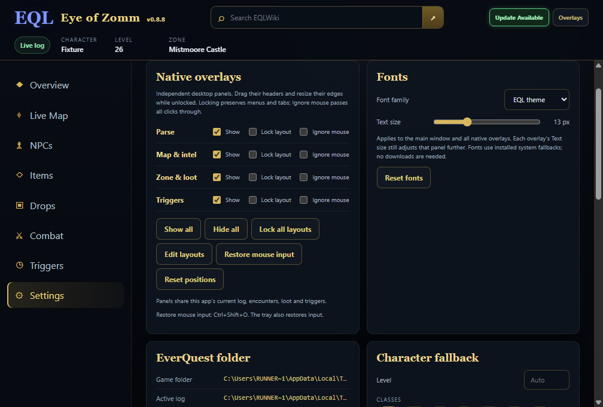

*Overlay settings, 0.8.8. Newer sections and sidebar entries are not shown.*

## Live Map and Crawl

Open **Live Map**, then choose **Map**, **Top down** or **First person**.
Supported map files come from your chosen game folder. Readiness indicators
show whether the folder, log, zone and `/loc` are available. Use **Center on
last /loc** to return to your last recorded position.

The cyan marker follows logged coordinates. Its arrow estimates movement,
not character facing. The native Map offers **Follow**, zoom and **Auto Z**;
change Z to inspect another floor, then restore Auto Z to follow logged height.
In top 3D, left drag pans and right drag rotates.

Choose a named mob or map label under **Navigate to**, then **Find path**.
Routing is optional and requires map validation; an unsupported destination
remains a marker. Static maps cannot know current doors or actors.

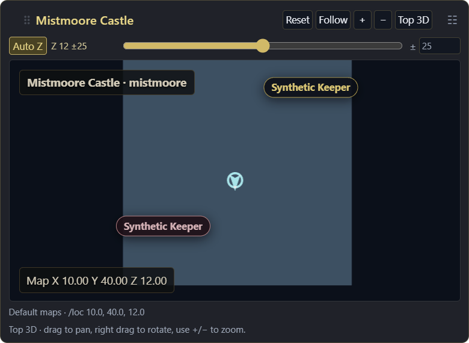

**Crawl** is shared between Map and Zone & loot. Fresh logged kills dim matching
targets and collapse their Intel drops until the next zone visit. Turn it off
to restore normal previews.

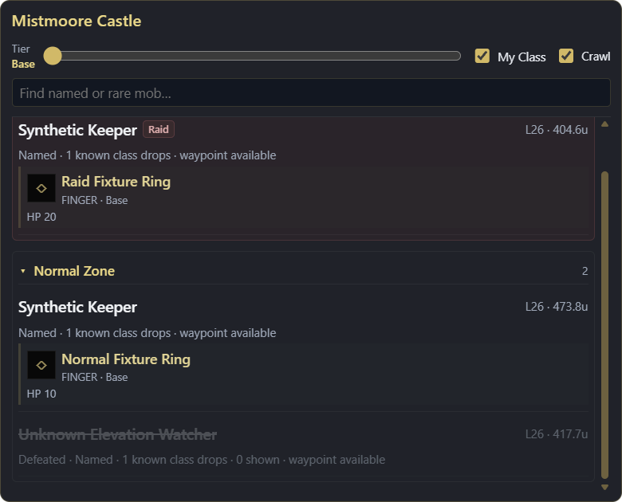

Read more: [Crawl](docs/CRAWL_MODE.md) · [map controls](docs/WINDOW_MAP_POLISH.md) ·
[routing limits](docs/ROUTE_REJECTION_AUDIT.md).

## NPCs, Items and Zone & loot

**NPCs** searches the cached wiki catalog. Keep **Current zone only** checked
for nearby sources, or clear it to browse other zones. **Items** adds class,
slot, era and tier filters. **Any** shows every class; **Auto** follows your
detected/profile classes. This filter does not change your Character.

Hover or keyboard-focus an item for its wiki-style card and linked effects.
Move the tier slider to compare previews: changed values are green and base
comparisons are muted. Previews never change recorded Character totals.


The **Zone & loot** overlay separates Normal and Raid Zone sources. Use
**Show More** for all matching drops; hover or focus a mob for **Details**,
**Route**, **Copy /waypoint**, **Wiki** and **Map**. Its Map action previews the
source without changing your logged location. A logged consider or named kill
can reveal the matching row. Copied waypoints are for you to paste.

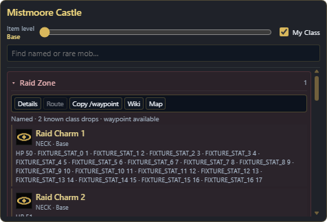

*Zone & loot, 0.8.8. Current versions also offer Crawl as shown above.*

Read more: [item previews](docs/SHARED_ITEM_SCALING.md) ·
[loot classification](docs/CONTRIBUTION_LOOT_CLASSIFICATION.md).

## Drops

Open **Drops** for this session's observed loot, source labels and counts.
These come from supported messages in the selected log, rather than everything
a monster could drop. Use NPCs or Zone & loot for the wiki's known loot list.
**New session** in Combat clears parse and loot totals while continuing at the
current log position; it preserves your characters and triggers.

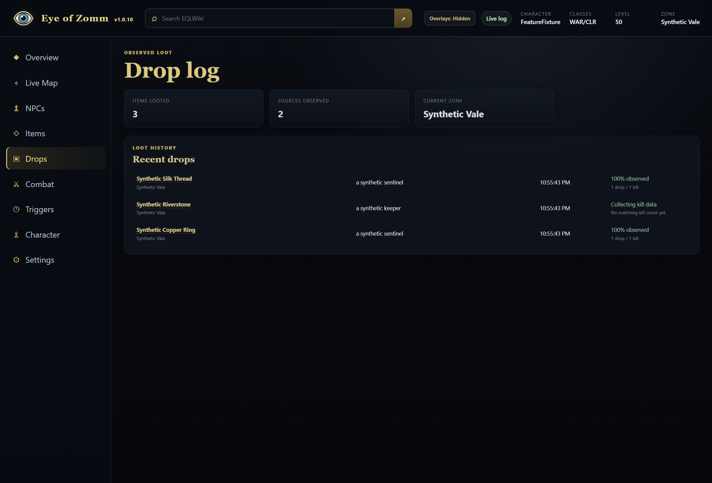

*Documentation capture of the actual Drops view with synthetic log events.*

## Combat and Parse

**Combat** shows session totals and recent encounters. The floating **Parse**
panel adds **Overview**, **Damage**, **Healing**, **Taken** and **Session** tabs.
Choose a whole session or encounter, then expand a combatant for abilities or
incoming attackers. **Live** retains a completed fight until another begins;
**Session** includes explicitly logged AA gains.

Results depend on the messages your game log contains. Pets keep their names;
unknown attackers remain unknown. Rune capacity is separate from measured
healing or absorption. Damage and taken damage describe the same hits, so
adding those columns would count them twice.

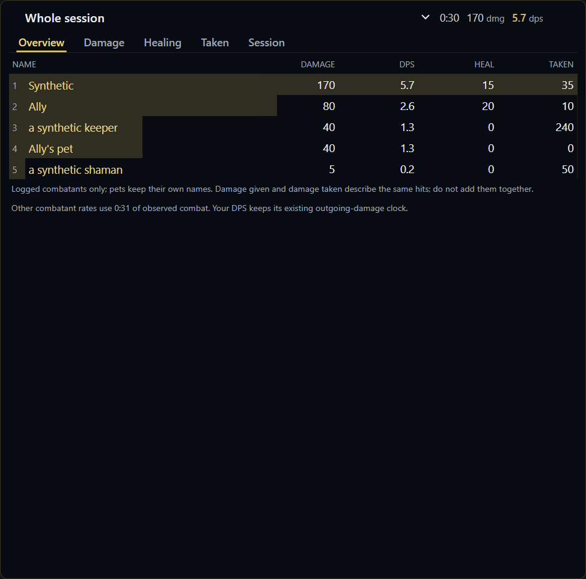

Read more: [combat scopes and log limitations](docs/COMBATANT_OVERVIEW.md).

## Triggers

Create a reminder or a literal/regular-expression log match in **Triggers**.
Use **Test match**, set a cooldown and choose sound, speech or a countdown.
Named captures can supply labels. Save a definition before **Fire now**.
**Running countdowns** manages manual/repeating timers; the floating Triggers
panel displays them. Respawn reminder durations are yours to supply, not a
claim about the monster's actual respawn period.

The optional **Swing → Show swing estimate** uses logged hits and misses;
log timestamp precision limits its accuracy.

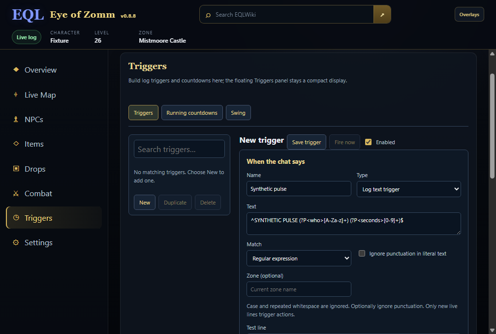

Read more: [triggers, countdowns and swing estimates](docs/TIMERS.md).

## Character

### Import inventory and achievements

1. Enter your character name, server, race, level and AA count. Check **two or
   three classes**. Characters are saved separately as **Character (Server)**.
2. Keep all gear equipped and run both commands in EverQuest:

   ```text
   /outputfile inventory
   /outputfile achievements
   ```

3. Click **Import files** once. EoZ reads the matching files from your chosen
   game folder or opens a native chooser. Both must validate before saving;
   cancellation or a failed import keeps the previous saved character.
4. Search and page through carried items, bank and personal depot. Keyring and
   unmatched exports have read-only source pages. Physical copies, locations,
   counts, manual work and sockets retain their meaning; bag contents do not
   become worn gear or attached Exaltations.

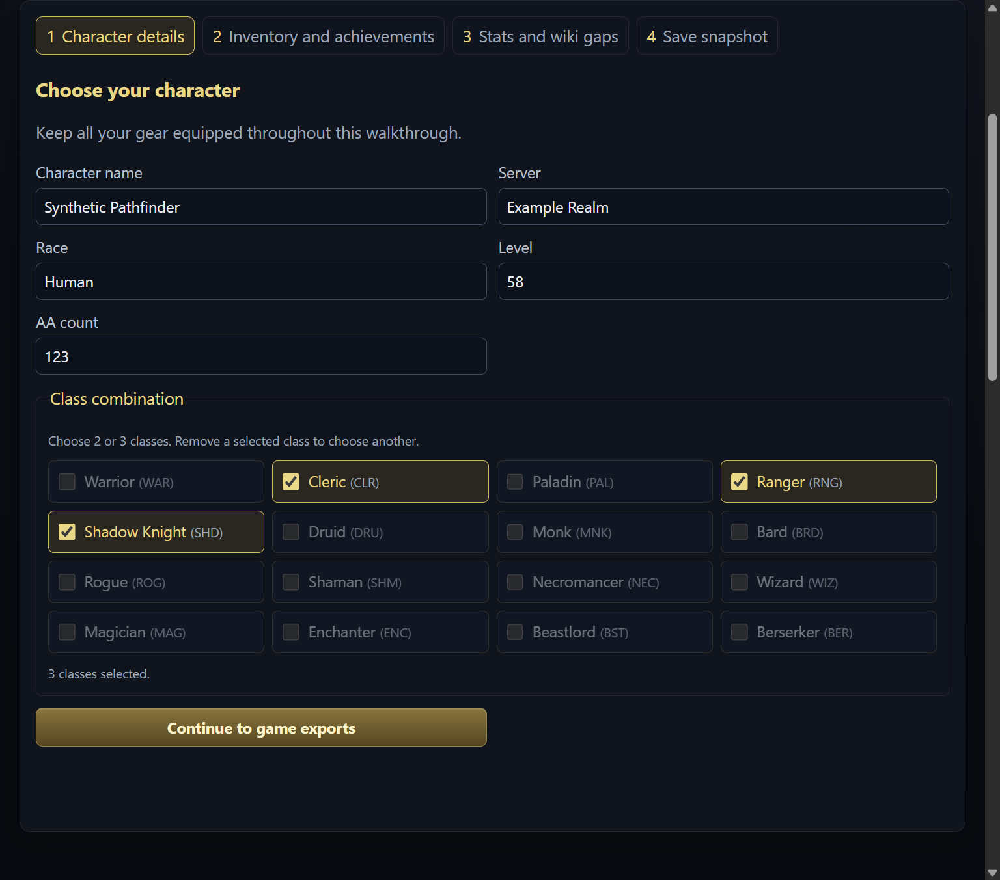

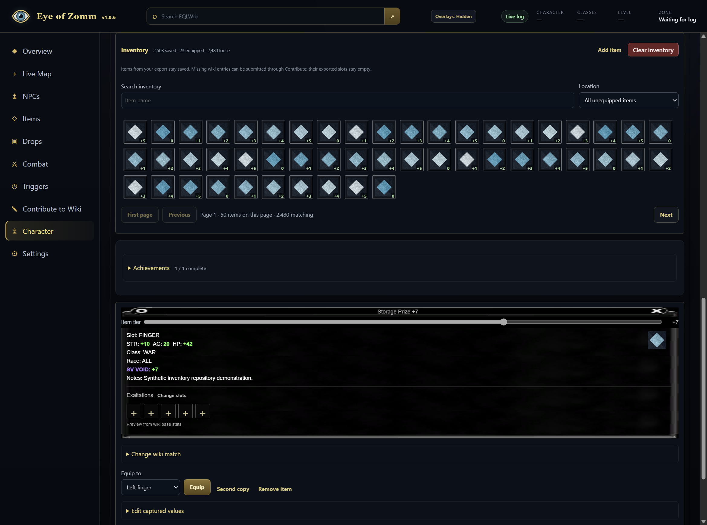

Desktop inventory grows in private on-disk storage rather than one large
browser value. Existing saves migrate with a recovery backup. Wait for pending
edits to save before switching characters or sharing.

### Review equipped, unbuffed stats

Keep gear on, open Inventory, show the full stat panel and click off buffs.
For **Default**, select **Stats** with both columns visible. For **Default
Modern**, scroll down to include the stat panel and Additional Modifiers.
The visible layout is recognized automatically.

Choose your game window and **Read character stats**, or enter values manually.
Correct uncertain numbers before **Use these stats and review**. Totals use
only your reviewed reading: gear, Exaltations, catalog tiers and old baselines
are not added. Reimporting gear requires a new current-stat review.

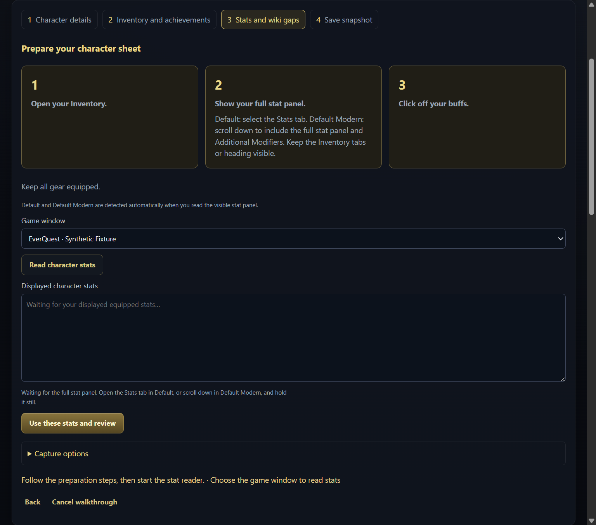

### Inspect, export and share

Hover or focus known equipped gear for its tier and Exaltations. Exaltation
summaries show names and effects. Unknown wiki items stay private and leave
public slots/sockets empty; contribute missing facts, sync accepted wiki data
and import a fresh export when ready.

**Copy PNG** and **Save PNG** create local equipment/stat images. **Share on my
User page** requires a wiki login and a final review. It updates the matching
Character (Server) sheet while preserving other characters and page content.
Equipped gear, reviewed totals and achievements can be public; carried/banked
inventory, raw exports and paths stay private.

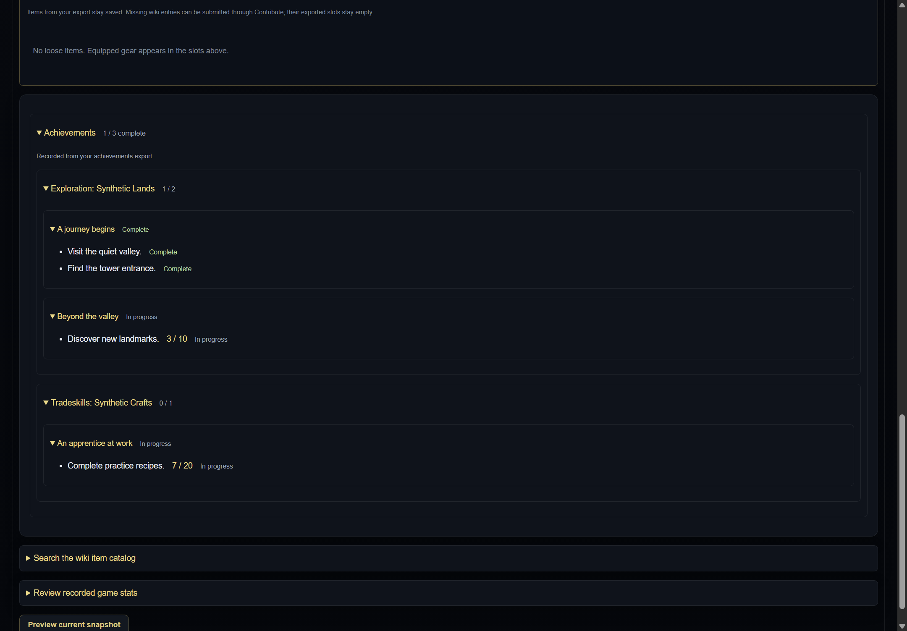

Optionally select or paste a picture in Share review. Check the whole image
before sharing. Selection is local until Share; skipping it keeps the current
wiki picture or **Add an image** placeholder. **Remove selected image** does
not delete a public file. Image selection works with Screen Reading off.

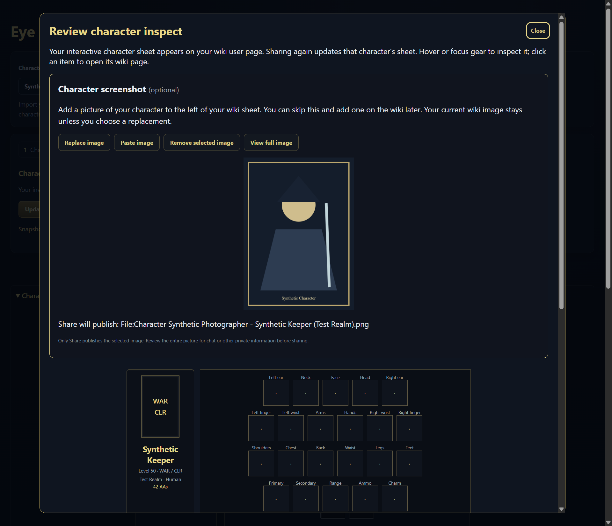

Read more: [walkthrough](docs/CHARACTER_WALKTHROUGH.md) ·
[private storage/recovery](docs/CHARACTER_STORAGE.md) ·
[achievements](docs/CHARACTER_ACHIEVEMENTS.md) ·
[Character screenshots](docs/CHARACTER_SCREENSHOTS.md).

## Contribute to Wiki

Review discoveries or manually add missing facts in **Contribute to Wiki**.
A task may update sources or locations on an existing page rather than create
an article. Review the match and destination first. Automatic gaps require
live public checks; failed checks do not prove that a page is missing.

For an item prompt, open its complete examine window. With Screen Reading
enabled, fresh matching readings can fill unedited fields and stage a
screenshot. A screenshot alone does not establish a new discovery.
Unknown-monster prompts can request your next `/loc`; stand at the spawn
before typing it. Chat item mentions do not establish a drop source.

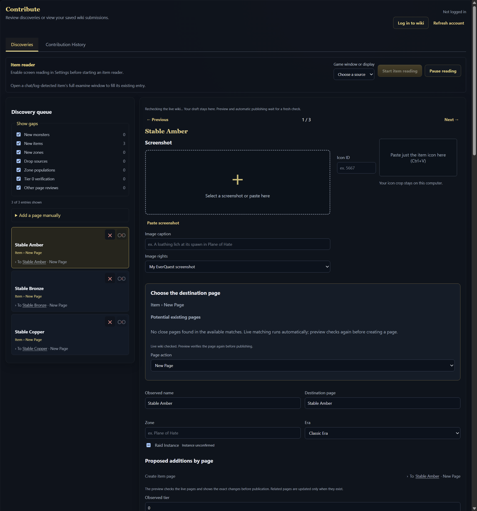

Use structured stats, class/slot choices, source rows and optional screenshots.
Unknown values stay blank. The local **Icon Finder** can match an icon crop
without uploading it. **Preview** shows the page plan; confirm review before
**Publish**. Signed-in automatic paths can also create an eligible freshly read
item or append verified live loot sources; ambiguous work remains for review.
Reopening historical logs does not publish their old observations.

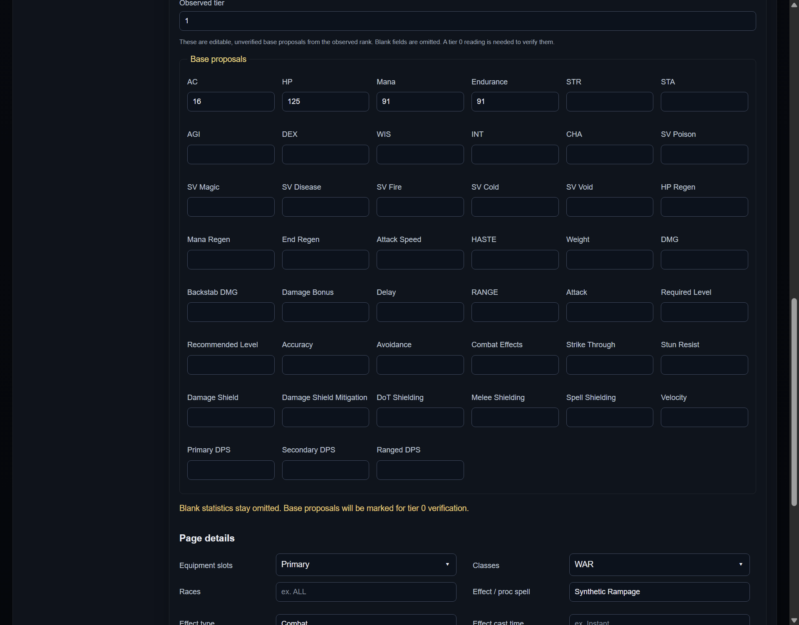

**×** dismisses a task; **∞×** ignores its entity until restored in
**Contribution History**. History lists this device's submissions for the
current wiki account, including partial/unconfirmed results and saved-page
links. It does not retry publication. EoZ-created/edited pages carry the
[EoZ category](https://eqlwiki.com/Category:EoZ).

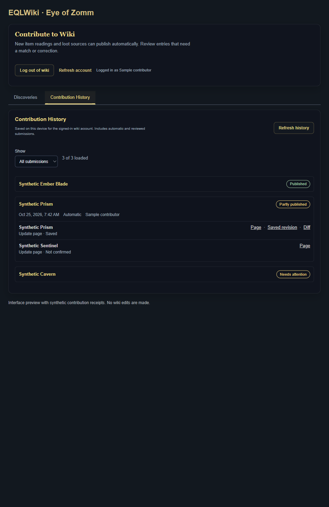

Read more: [item form](docs/ITEM_CONTRIBUTION_FORM.md) ·
[History](docs/CONTRIBUTION_HISTORY.md) · [chat discoveries](docs/CHAT_ITEM_BOUNDARIES.md) ·
[page tracking](docs/WIKI_PAGE_TRACKING.md).

## Optional Screen Reading

**Settings → Screen reading** is the master permission for local OCR/capture
and starts disabled. Choose the source to read; Default and Default Modern
stat panes are supported, while other skins remain unverified. Calibration
selects a complete pane; **Full frame** resets it. Review uncertain numbers.

Opening Contribute can start its reader while permission is enabled.
**Pause automatic reading** keeps it paused until you resume. Character and
Contribute coordinate ownership. Turning the master permission off stops
readers and pending OCR, including screenshot-file/clipboard OCR; logs,
manual text and inventory imports continue working.


*Historical source controls, 0.9.0; the master permission was added later.*

Read more: [capture and review guide](docs/CAPTURE_CONTRIBUTIONS.md).

## Features and Settings

Use Settings to choose the components you want available. Feature controls
preserve saved characters, triggers and drafts. Availability is separate from
permission to read a screen or upload optional observations. See
[feature controls](docs/FEATURE_CONTROLS.md) for switches and dependencies.
Disabled features disappear from menus, Settings cards, Overview and related
shortcuts. Their switches stay in **Settings → Features** so you can restore them.

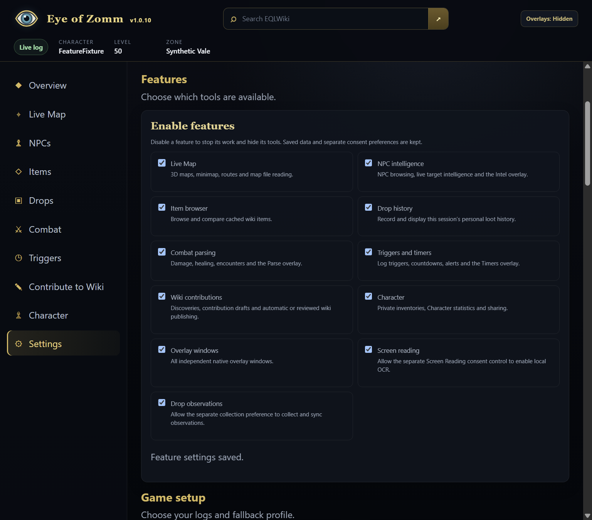

| Topic | What to change |
| --- | --- |
| Fonts | Font family, installed font selection and 10–20 px base text size; overlays also have their own adjustment. |
| EverQuest folder / log | Game folder, a chosen log, or automatic newest-log selection. |
| Native overlays | Visibility, layout lock, mouse passthrough and position recovery; opacity/text controls stay on individual panels. |
| Screen reading | Explicit capture permission, source and local reading controls. |
| Application updates | Check/download the next version and choose startup-download behavior. |
| Wiki data | See dataset/check status and use **Sync with Wiki**. |
| About Eye of Zomm | Open the illustrated What's new archive or report an issue. |

### App updates and wiki data are separate

An **application update** changes installed code and interface. A newly
verified Windows update offers a five-second restart countdown that you can
cancel. Linux reveals the verified AppImage/deb for manual installation.

**Sync with Wiki** updates cached items, NPCs, icons and source records.
Official packages include a production snapshot. Startup/hourly checks while
EoZ is open use a small manifest and download changed data; failed checks keep
the last valid cache. Item formulas update with the application, without
background formula polling.

[Public game-data download](https://raw.githubusercontent.com/Maergoth/EQL-EOZ/dataset/eqlwiki-eye-of-zomm-data.json.gz) ·
[Version/checksum manifest](https://raw.githubusercontent.com/Maergoth/EQL-EOZ/dataset/manifest.json).
This export is game/wiki entity data, not a private wiki account or SQL backup.

### Optional drop observations

**Collect and sync drop observations** saves minimal fresh kill/loot evidence
and sends due batches while running and signed in, at most hourly with backoff.
It excludes player names, raw chat/logs, paths, coordinates and screenshots.
It is separate from article edits and does not calculate drop probabilities.
Disable collection/upload to retain pending data without sending it.

## Help and contributing

EoZ reads supported files from your chosen folder and optional selected screen
sources. It does not inspect game-process memory, inject code, patch game files
or synthesize gameplay input. See [SAFETY.md](SAFETY.md).

When [reporting an issue](https://github.com/Maergoth/EQL-EOZ/issues), include
the app version and relevant visible status. Keep private logs/exports, chat
screenshots and account information out of public reports. Settings offers a
sanitized diagnostic export.

Use [DEVELOPMENT.md](DEVELOPMENT.md) for setup, architecture, component/style
contracts and validation; [CONTRIBUTING.md](CONTRIBUTING.md) describes contribution
boundaries. [CHANGELOG.md](CHANGELOG.md) retains the complete release history.
Eye of Zomm is [MIT licensed](LICENSE); bundled notices remain in `THIRD_PARTY/`.
