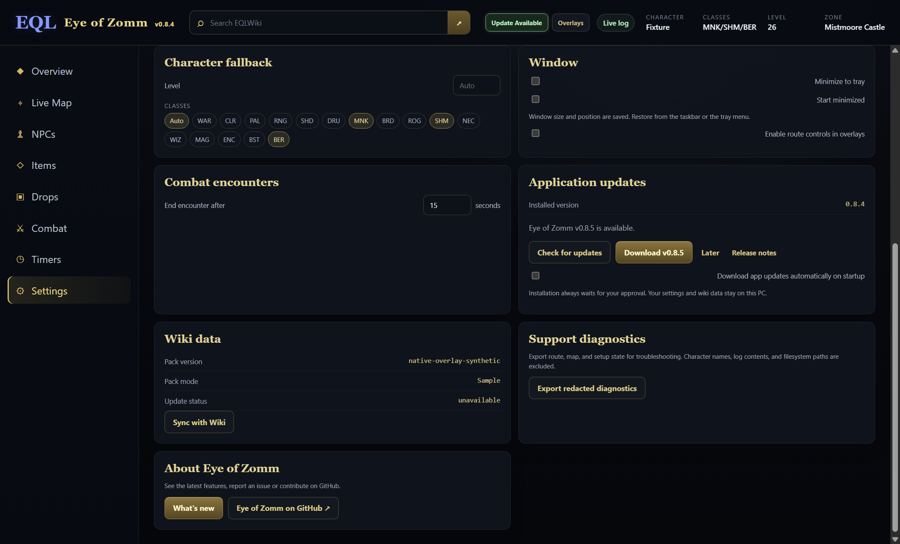

# EQLWiki — Eye of Zomm

**Eye of Zomm** is a local-first Windows app for **EverQuest Legends**. It reads ordinary game logs, combines them with cached EQLWiki knowledge, and keeps maps, named-mob loot, combat parses and timers in separate desktop windows.

[Download latest installer](https://github.com/Maergoth/EQL-EOZ/releases) · [EQLWiki](https://eqlwiki.com) · [Report an issue](https://github.com/Maergoth/EQL-EOZ/issues) · [Changelog](CHANGELOG.md)

## Get started

1. Install the latest `EQLWiki-Eye-of-Zomm-Setup-<version>-x64.exe` from [Releases](https://github.com/Maergoth/EQL-EOZ/releases).
2. Choose your EverQuest Legends folder on first launch. Enable logging in the game; EoZ follows the newest `eqlog_*.txt` under `Logs`, or a specific file selected in Settings.
3. Emit `/who` to establish your character's zone, level and classes, and `/loc` to place your position on the map. Later logged locations update it automatically.
4. Open **Overlays** to arrange Parse, Map, Zone & loot and Timers. Configure them in **Settings → Native overlays**. Reopen **Settings → About Eye of Zomm → What's new** for the illustrated tour.

The installer creates normal Start Menu/Desktop shortcuts and registers `eqleoz://` so EQLWiki can open the app. Beta installers may be unsigned and show a Windows publisher prompt; see [signing status](SIGNING.md).

## A look around

These screenshots show the actual **0.8.4 Electron interface with synthetic log, wiki, map and update-state fixtures**. They contain no player records, proprietary zone geometry or live game capture. Native game compositing and OS-wide DPI behavior require separate [Windows acceptance checks](docs/WINDOWS_MANUAL_TEST.md).

### A normal desktop workspace

Move and resize the main window normally. Its size, position and maximized state are remembered, with recovery when a display is unavailable. **Minimize to tray** and **Start minimized** are optional Settings choices. When the tray is unavailable, minimizing keeps the normal taskbar recovery path. The main window has no Pin to top mode; overlays retain their own lock and mouse controls.



### Maps that stay beside the game

The native Map reads your client text maps and shares the logged position, named destinations and validated route with the main app. Reveal its header for **Reset**, Follow, zoom and a button cycling **Map → Top → First person** in this window. Its 3D scene loads only when used. Use Z controls to inspect another elevation; monster names and markers share interactive pointer targets. The complete main **Map Explorer** keeps its own views and zoomable Local Map.

Routing is an opt-in. A line appears only after collision checks approve it; a guarded Recast/Detour candidate may refine the established route after the same checks. An unreachable or unverified destination remains a marker. Static archives do not reveal live doors or actors. [Route validation](docs/ROUTE_REJECTION_AUDIT.md) records working detours and remaining limits.


### Named mobs, raid sources and complete loot

**Zone & loot** separates Normal Zone and Raid Zone sources, with red **Raid Zone** intel shown first. **Item Level Slider** and **My Class** stay anchored above the scrolling list. Hover or keyboard-focus a mob name for Details, Route, Copy /waypoint, Wiki and Map. Its Map action opens a first-person preview at that source, keeping your logged position unchanged. Use **Show More** for all matching drops. Class-filtered loot excludes statless and weight-only records. A logged consider or named kill selects and expands its row with a mild visual/audio cue, without activating the window.

Item details use local wiki icons and Item Level Slider rules. **Through era** includes items through the chosen era. Activating a located NPC name copies a paste-ready `/waypoint Y X [Z]`; row-level Route actions start navigation when routing is enabled.


### Timers, triggers and combat parses

Create manual countdowns or literal/regex log triggers on the main **Timers** page. Test a match, use named captures, set cooldowns and choose local sound/speech cues. Running timers and the observed swing bar appear in the compact Timers window. You supply reminder durations; EoZ does not know a mob's respawn period.

The independent **Parse** window has **Overview / Damage / Healing / Taken / Session** tabs and encounter selection. One shared session reads the log for every panel. The swing bar estimates your outgoing melee rounds from logged hits and misses; one-second log timestamps limit its precision. See [timer behavior](docs/TIMERS.md).


Unlock an overlay to move/resize it. Locking leaves its tabs and menus interactive; **Ignore mouse** passes clicks through. Recover from Settings, the tray, or **Ctrl+Shift+O** when registered. Layout, opacity and font scale are saved separately for each panel. Closing the main window while overlays are visible keeps their shared session running; use **Quit Eye of Zomm** in the tray to exit.

## Your files stay local

EoZ reads logs and supported map/archive files under the folder you choose. It never reads game-process memory, injects code, patches game files, sends game commands or synthesizes gameplay input. See [SAFETY.md](SAFETY.md).

When a complete wiki catalog confirms that an encountered NPC or looted item is missing, an inline Timers notice offers **Screenshot** or **Ignore**. Screenshot opens an explicit window/display choice and copies the selected image to your local clipboard. You decide where to paste it; nothing uploads automatically. Notices pause their dismissal timer while hovered or keyboard-focused.

Global **Search EQLWiki** opens a wiki search in your browser. Item/NPC cards open their exact wiki pages. Ordinary search and filtering use cached data and do not crawl wiki pages.

## Two separate updates

| Update | What it changes | Where to use it |
| --- | --- | --- |
| Application update | Installed EoZ code and interface | **Settings → Application updates**: check, download, then explicitly approve the normal Windows installer |
| Wiki data update | Cached NPCs, items, icons, zone aliases and source records | **Sync with Wiki**, also checked at startup |

Verified application downloads can wait until later. Startup downloading is optional and off by default; installation always requires approval. Settings, folder/log choices and cached wiki data stay in the existing profile. Older builds without the updater need one normal installation of a newer build first.

The wiki data flow is server-side and low priority:

```text
EQLWiki content → local exporter → gzip + SHA-256 manifest
               → GitHub dataset branch → verified local cache
```

Official installers include a production snapshot, so first launch does not reconstruct the wiki corpus. Startup and **Sync with Wiki** check only the small GitHub manifest; a changed version downloads and verifies the pack before replacing the cache. Players do not poll EQLWiki for dataset updates.

The producer reads MediaWiki's local content/database services and builds zone aliases, NPC locations/provenance, normal/raid source variants, items and embedded icons. A weekly/manual host job publishes only the filtered manifest and compressed pack to the dedicated `dataset` branch. Installing producer changes and rebuilding the dataset are separate from a desktop release; see [server operations](server/README.md).

## Development and validation

Node.js 22+ is required. Normal development works on Windows, macOS or Linux; the production installer targets Windows x64.

```bash
npm ci
npm test
npm start
```

Fetch the verified production bootstrap before catalog checks or packaging:

```bash
node scripts/fetch-bootstrap-pack.mjs --required
npm run test:catalog
npm run test:desktop-worker
npm run dist:win
npm run test:artifact
```

Screenshots can be reproduced from the real Electron synthetic fixture without opening an actual game installation:

```bash
node scripts/test-native-overlays.mjs --screenshots <output-directory>
```

Tests with synthetic content do not establish live route quality, physical overlay focus/passthrough, monitor/DPI transitions or installer acceptance. Keep client archives, player logs, database snapshots, settings, generated packs and private diagnostic exports out of Git.

| Documentation | Purpose |
| --- | --- |
| [Contributor handoff](docs/HANDOFF.md) and [implementation status](docs/IMPLEMENTATION_STATUS.md) | Architecture, source ownership and exact next work |
| [Product vision](docs/UX_VISION.md) and [PNUT interaction plan](docs/PNUT_UX_PLAN.md) | UX contracts and feature scope |
| [Window/map follow-up](docs/WINDOW_MAP_POLISH.md) | Current window, map and tour changes |
| [Map validation](docs/MAP_VALIDATION.md) and [destination-only audit](docs/ROUTE_REJECTION_AUDIT.md) | Real local-archive observations and limits |
| [Navigation architecture](docs/NAVMESH_EVALUATION.md) | Guarded worker routing and independent collision validation |
| [Validation report](VALIDATION.md) and [Windows checklist](docs/WINDOWS_MANUAL_TEST.md) | Automated gates and remaining manual acceptance |
| [Contributing](CONTRIBUTING.md), [security](SECURITY.md) and [signing](SIGNING.md) | Contribution and release boundaries |

The main source areas are `app/` (UI, parsing, maps and local knowledge), `desktop/` (Electron, overlays and file bridge), `server/` (wiki export), `scripts/` (build/validation), `tests/` and `wiki/` (optional launcher integration).

Eye of Zomm is [MIT licensed](LICENSE). Zone Viewer, Recast/Detour and PNUT notices remain under `THIRD_PARTY/`.
