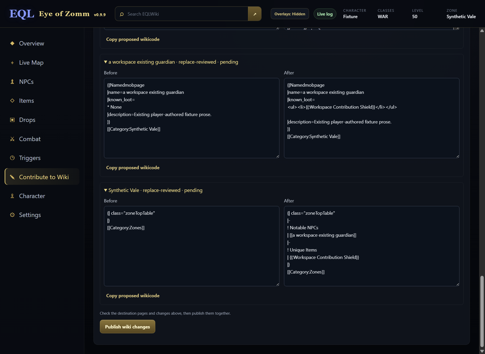
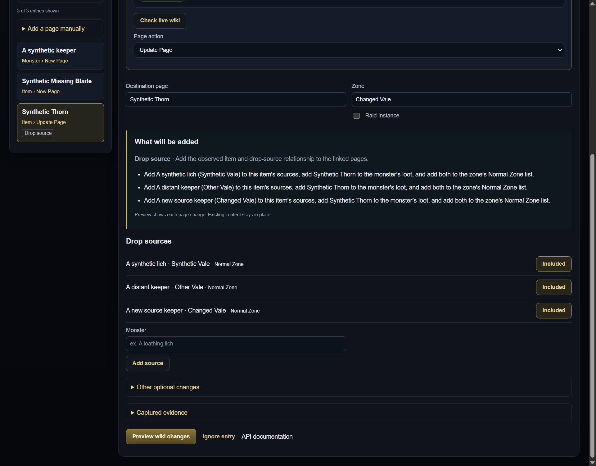
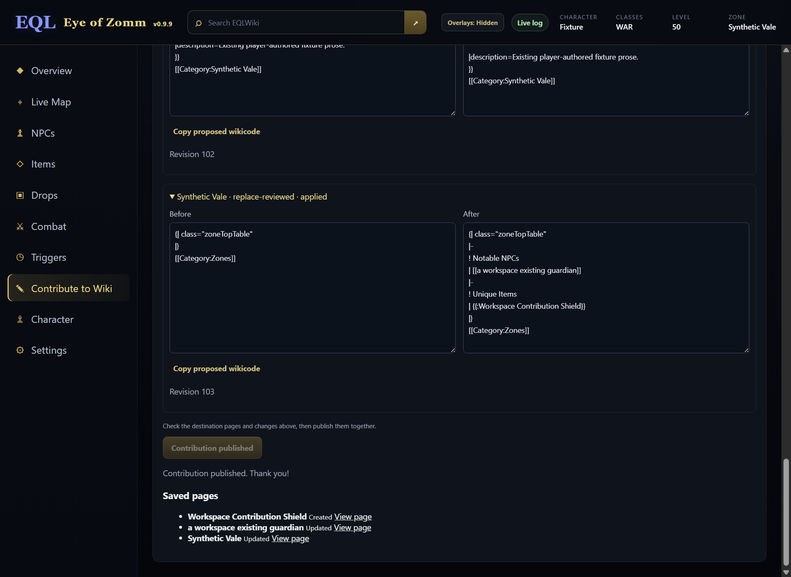
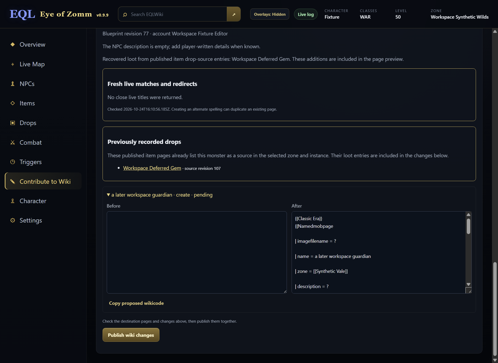

# Contribution form: simpler review, multiselects and inline icon paste

Prepare a separate next-release PR from published 0.9.9. Do not merge, release,
refresh datasets or change installed profiles/wiki pages in this task.

The user corrected the initial checkbox request: **both Classes and Slots must
be multiselect dropdowns, not checkboxes**. Use fixed canonical game choices,
clear selected summaries and keyboard support. Preserve unedited legacy draft
values, optional blank fields and the existing array storage/submission format.
Selecting classes must handle ALL/NONE consistently. Do not introduce free text
that can produce mistyped abbreviations.
Selected Classes/Slots must agree with visible `Class:`/`Slot:` stat lines,
not only article categories. Existing pages change only explicitly edited fields.

Icon matching belongs inside the existing Icon ID field: one focusable paste
box, a local preview/status and closest-result choices after an explicit paste.
Remove the separate Icon Finder section and browse/file/search controls from
this item form. Retain exact artwork aliases, user selection, image bounds,
local fingerprint processing and stale-result/disposal guards. An icon paste
must not trigger the form's general screenshot attachment handler.

The follow-up request removes duplicate Source Zone entry and repeated approval
checkboxes. Adding a drop source uses the current **Zone** and **Raid Instance**
above; existing sources retain their own zone/instance. A missing zone focuses
the existing field instead of creating a second input. Keep source inclusion
choices and data filters, which select content rather than approve publication.

The flow is **Preview wiki changes → Publish wiki changes**. Preview explicitly
selects the current destination for a fresh guarded plan. Show all live matches,
redirects, upload details, account and complete before/after page changes.
Publish is the single final authorization; no destination, duplicate-result or
per-page approval checkbox is needed. Preview/resume never writes automatically.
Draft edits invalidate previews; a saved partial plan requires an explicit Retry.
Keep the desktop account, live duplicate, blueprint revision, review-digest,
create-only/content/revision guards and reconciliation of partial writes.

Successful publication must provide **View page** links for every confirmed
saved page, whether an item, monster, zone, spell or related update. Use the
canonical title saved in the plan, with a fixed wiki origin; show already-applied
pages during a partial result and after restart. Pending, uncertain and failed
pages must not claim success. Do not navigate automatically.

Empty item template fields stay blank, including effect metadata. A chosen
effect/proc must replace a stale `Effect: ?` line rather than be suppressed by
it. Preserve unrelated item text and scoped existing-page edits. Keep `?` for
missing factual monster fields such as HP and spawn location; keep the existing
new-monster location requirement and all server-side edit guards.

## Item-first / monster-later relationship completion

Current verified gap: the trusted planner updates existing item/monster/zone
pages together, but skips a missing related page with a warning. Explicit-corpse
logs prefill monster loot; a manually added item source does not reliably
survive into a monster created later. A warning is not deferred execution.

Resolve this from persisted wiki facts when preparing a monster contribution:
query bounded live backlinks to its canonical title, read candidate item pages,
and accept only an active Itempage `dropsfrom` relationship in the same zone
and Normal/Raid instance. A prose mention/backlink alone is insufficient.
Saved/archived local item drafts supply bounded lookup hints to cover immediate
indexing lag and spelling aliases; those hints require the same live-page proof.
This does not depend on a dataset refresh or the old item draft remaining open.

Recovered items appear in the complete monster preview, preserving existing
Common/Unique classification and unrelated content. The normal Publish action
still controls every edit. Keep bounded queries, explicit incomplete/failure
reporting, canonical identities, revision/create guards and partial retry.
No background wiki writes or fabricated monster scaffold are introduced.

Ownership: relationship proof helper/model fixtures — choice agent; live lookup,
trusted plan integration and client fixtures — wiki client agent; local hints,
review provenance, native workflow, docs and PR amendment — root.

Acceptance: item-first / missing-monster submission then later fresh-client
monster creation includes the item; local hints bridge indexing lag; wrong-zone,
wrong-instance and unrelated backlinks are excluded; existing loot is not
duplicated/reclassified; Preview makes no writes; partial results remain
resumable. Source code locations: `desktop/wiki-client.cjs`,
`app/contribution-model.js`, `app/contribution-queue.js`,
`app/capture-workspace.js`, their focused tests and the native workspace fixture.

### Separate wiki-side requirement: another editor creates the monster

The user clarified that the later creator may use the wiki directly. EoZ
recovery alone cannot satisfy that case. Live read-only verification found
`Template:Namedmobpage` revision 149842 only renders authored `known_loot` and
`common_loot`; `Template:Itempage` revision 176024 only renders `dropsfrom`.
Neither currently performs a reverse relationship lookup.

The wiki needs a shared read-only reverse lookup from published item source
rows, displayed alongside authored monster loot regardless of the page creator.
Preserve manual loot, classification, attribution and normal/raid context;
do not create bot edits merely to copy lists. Require a verified zone/instance,
deduplicate exact canonical item identities and retain existing item hover
contracts. This needs a separate wiki staging PR and, if its template/DB content
changes, a reviewed revision plus private backup/publication receipt. It is
planned separately and must not be claimed live or completed by the app PR.

Concrete wiki implementation sequence:

1. Branch from current wiki `origin/staging`, preserving unrelated local work.
   Register a small read-only NPC-loot renderer/parser function through active
   `extensions/DynamicZoneList/DynamicZoneList.php`; isolate source lookup/proof
   in a class. Existing `DynamicZoneList_body.php` offers query patterns, but
   its historical parser is insufficient for protected text and instance proof.
2. Discover bounded item candidates from backlinks/zone context, then verify
   current Itempage source rows. Preserve canonical aliases and normal/raid
   boundaries; fail closed on ambiguity or incomplete results. Do not turn an
   ordinary backlink or prose mention into a drop assertion.
3. Publish one reviewed call in `Template:Namedmobpage`, preserving authored
   Common/Unique loot and suppressing duplicates across both lists. Use a neutral
   **Additional recorded drops** group where the item source gives no rarity.
   Render through existing item transclusions to retain wiki item cards/hovers.
4. Add optional explicit instance context to template/blueprints. Existing cards
   have no instance parameter; infer only unambiguous enclosing sections.
   Bound result caching, parser freshness and rendered-item dependencies so a
   new item source becomes visible without copying lists in background edits.
5. Test a monster created directly by a different wiki editor after the item,
   preservation of authored lists, duplicates, hovers, aliases, both instances,
   new/changed source cache refresh and ambiguity. Source deployment and reviewed
   template/blueprint DB publication need separate receipts before promotion.

The eventual app/API integration should reuse this lookup/proof service instead
of maintaining a second authoritative relationship store. Any public API support
must be documented on the wiki and preserve the existing attributed edit flow.
No new schema or hourly repair job is required for the read-only rendering plan.

## Ownership and source map

Worktree `D:/EQLWiki/.local/worktrees/eoz-item-form`, branch
`codex/item-form-class-icons`, based on main
`481ce17c9d4202f36092eac12c0effd329e7eca9`.

- Choice agent: shared contribution-choice-picker module and focused tests for
  Classes/Slots multiselect markup, keyboard/state and legacy preservation.
- Icon agent: app/icon-finder.js compact paste mode and focused widget checks.
- Root: contribution-editor.js and capture-workspace.js/CSS integration, native
  item-form checks/screenshots, developer documentation, final commit and PR.

Authenticated attributed page publication, identity/revision validation and
private capture boundaries stay in force. The pending hover/discovery PRs are
independent; this PR does not claim their changes are already released.

## Acceptance ledger

- [x] Fixed-choice Classes and Slots multiselect dropdowns, with keyboard and
  optional/ALL/NONE behavior; unedited old draft values remain intact.
- [x] Inline Icon ID paste box and post-paste matches; no separate finder UI.
- [x] Icon paste remains local and cannot attach a screenshot accidentally.
- [x] Meaningful source/native checks, narrow/large-text visual review and
  updated documentation; synthetic captures only.
- [x] Commit/push, create/attach next-release PR #26 and inspect initial CI.
- [x] Reuse Zone for new drop sources; preserve other-zone sources and require
  a zone before adding a source.
- [x] Replace repeated approvals with explicit Preview and one Publish/Retry,
  retaining full diffs and host validation.
- [x] Validate the review simplification; push its amendment to PR #26.
- [x] Verify and push successful-page links for every page kind and partial
  results, including resumed plans.
- [x] Fix selected effect serialization and blank item fields; retain factual
  monster unknowns and scoped existing-page patches.
- [x] Recover published item sources when the monster is created later through EoZ, with
  live relationship proof, local hints and reviewed reciprocal completion.
- [ ] Separate wiki staging work: reverse-source rendering for a monster created
  directly in the wiki editor by any contributor (not implemented by this PR).

## Validation and maintenance

The complete source suite passed, including the registered canonical-choice
regression. The actual Chromium workspace checks multi-selection, Space/Escape
keyboard input, saved canonical arrays, no checkbox inputs in the dropdowns,
upward viewport-edge placement, and an inline icon paste that never also creates
a screenshot attachment. The real-main/preload contribution flow passed with an
isolated profile and loopback wiki, including native icon fingerprint matching
and reviewed attributed publication.

`npm run test:icon-finder-ui` separately covers real PNG/canvas fingerprints,
exact artwork aliases, no requests before explicit paste, bounded crops, stale
replacement responses and disposal. Keyboard Tab/Shift+Tab return to the trigger
before normal focus navigation; menus use available viewport/scroll-panel room.
These are synthetic fixture checks, not an installed-app or live-game test.

The simplification amendment passes the complete source suite and unchanged
desktop wiki-client safeguards. The real-main/preload loopback flow verifies
zero writes on Preview, all three related page diffs visible, a single Publish
with no approval boxes, stale-review invalidation, and an explicit partial Retry
after restart without repeated completed edits. The Chromium form check verifies
blank-zone refusal/focus, current-Zone reuse, case deduplication and preservation
of existing other-zone sources. The historical `test:workspace-098` command now
forwards to the current superset fixture rather than expecting retired controls.

The later page-link/effect amendment passes focused contribution, editor,
choice-picker, client, base-recovery and tier-zero checks. The real-main loopback
workflow confirms links for the created item immediately during a partial
result, retains those links after restart, and adds the successful monster and
zone links after explicit Retry. Pure cases cover spell links too, fixed-origin
escaping, and no success links for pending/failed/uncertain pages. The selected
effect replaces a placeholder without losing other effects, including names
with escaped entities. Explicit changes to existing effects and Class/Slot lines
are scoped and idempotent; unknown item metadata stays empty and NPC factual
unknowns/location requirements remain. The prior complete source-suite receipt
belongs to the review simplification; this follow-up uses the focused checks
and the same complete native contribution workflow, without repeating unrelated
route/OCR checks. No production writes or installed-profile changes occurred.

Item-first / EoZ-monster-later validation passed focused model, queue, client,
editor, attachment and contribution checks plus the real-main/preload fixture.
It publishes an item with a missing monster source, recovers it through a live-
verified local hint while backlinks lag, removes the old item draft, restarts,
then recovers the published backlink and creates the monster with one loot entry.
The original correct item source is not rewritten. Client fixtures also cover
false/protected/wrong-zone/raid links, redirect aliases, complete batch coverage,
caps/offline blockers, Common/Unique preservation, source/alias revision changes,
digest tampering and uncertain partial retry. Recovery is bounded to two backlink
pages, 100 source titles and 100 aliases, using batches of ten; this is not an
unbounded background crawl. No direct-wiki-creation behavior is claimed.

No icon crop is uploaded, no new artwork/IDs are introduced, and the regular
article screenshot controls remain separate. The full finder mode remains
available to existing non-form callers. The user explicitly replaced the
initial checkbox idea with multiselect dropdowns for both fields. This candidate
does not change the Character inventory slots or retired capture flow.
