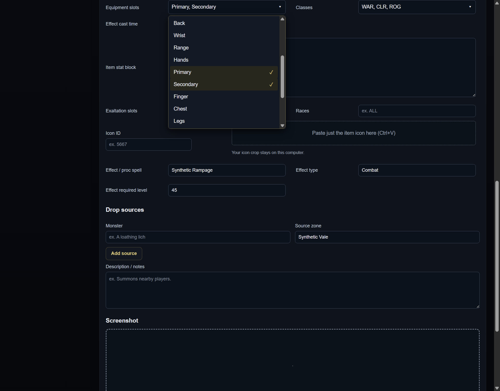
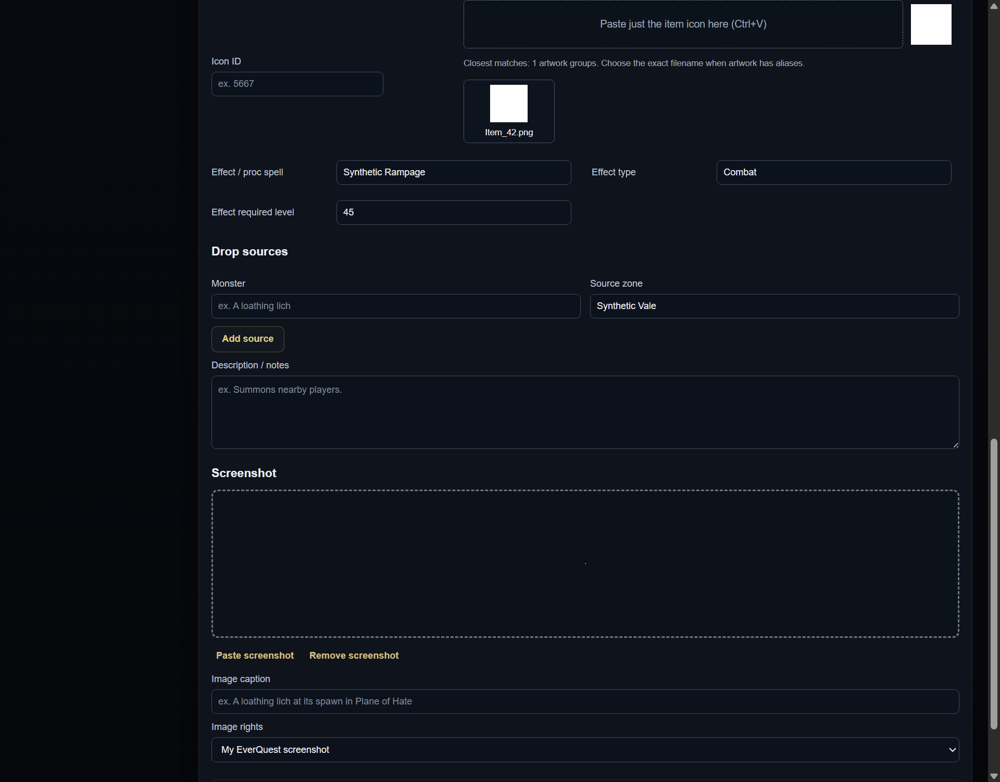

# Contribution item form: multiselects and inline icon paste

Prepare a separate next-release PR from published 0.9.9. Do not merge, release,
refresh datasets or change installed profiles/wiki pages in this task.

The user corrected the initial checkbox request: **both Classes and Slots must
be multiselect dropdowns, not checkboxes**. Use fixed canonical game choices,
clear selected summaries and keyboard support. Preserve unedited legacy draft
values, optional blank fields and the existing array storage/submission format.
Selecting classes must handle ALL/NONE consistently. Do not introduce free text
that can produce mistyped abbreviations.

Icon matching belongs inside the existing Icon ID field: one focusable paste
box, a local preview/status and closest-result choices after an explicit paste.
Remove the separate Icon Finder section and browse/file/search controls from
this item form. Retain exact artwork aliases, user selection, image bounds,
local fingerprint processing and stale-result/disposal guards. An icon paste
must not trigger the form's general screenshot attachment handler.

## Ownership and source map

Worktree `D:/EQLWiki/.local/worktrees/eoz-item-form`, branch
`codex/item-form-class-icons`, based on main
`481ce17c9d4202f36092eac12c0effd329e7eca9`.

- Choice agent: shared contribution-choice-picker module and focused tests for
  Classes/Slots multiselect markup, keyboard/state and legacy preservation.
- Icon agent: app/icon-finder.js compact paste mode and focused widget checks.
- Root: contribution-editor.js and capture-workspace.js/CSS integration, native
  item-form checks/screenshots, developer documentation, final commit and PR.

Existing review/identity gates, authenticated attributed page publication and
private capture boundaries stay in force. The pending hover/discovery PRs are
independent; this PR does not claim their changes are already released.

## Acceptance ledger

- [x] Fixed-choice Classes and Slots multiselect dropdowns, with keyboard and
  optional/ALL/NONE behavior; unedited old draft values remain intact.
- [x] Inline Icon ID paste box and post-paste matches; no separate finder UI.
- [x] Icon paste remains local and cannot attach a screenshot accidentally.
- [x] Meaningful source/native checks, narrow/large-text visual review and
  updated documentation; synthetic captures only.
- [ ] Commit/push, create/attach next-release PR and inspect initial CI.

## Validation and maintenance

The complete source suite passed, including the registered canonical-choice
regression. The actual Chromium workspace checks multi-selection, Space/Escape
keyboard input, saved canonical arrays, no checkbox inputs in the dropdowns,
upward viewport-edge placement, and an inline icon paste that never also creates
a screenshot attachment. The real-main/preload contribution flow passed with an
isolated profile and loopback wiki, including native icon fingerprint matching
and reviewed attributed publication.

`npm run test:icon-finder-ui` separately covers real PNG/canvas fingerprints,
exact artwork aliases, no requests before explicit paste, bounded crops, stale
replacement responses and disposal. Keyboard Tab/Shift+Tab return to the trigger
before normal focus navigation; menus use available viewport/scroll-panel room.
These are synthetic fixture checks, not an installed-app or live-game test.

No icon crop is uploaded, no new artwork/IDs are introduced, and the regular
article screenshot controls remain separate. The full finder mode remains
available to existing non-form callers. The user explicitly replaced the
initial checkbox idea with multiselect dropdowns for both fields. This candidate
does not change the Character inventory slots or retired capture flow.
