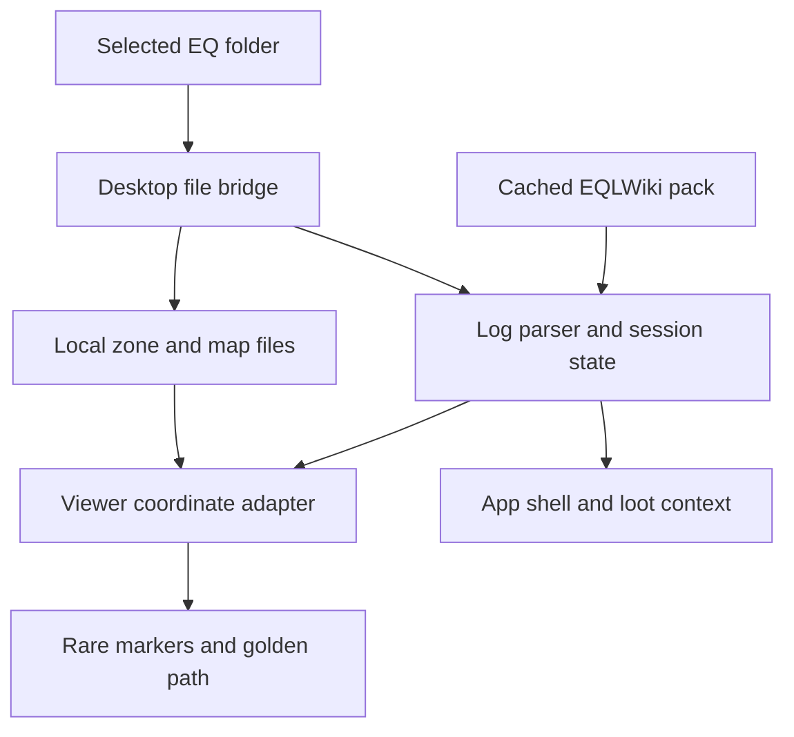

# Eye of Zomm contributor handoff

Current `v1.0.9` candidate: tag generated and edited wiki pages with the page-only EoZ category before preview hashes and publication. Preserve manual source, sort keys, managed Character identities and image reuse; older untagged saved drafts require a fresh Preview. See [wiki page tracking](WIKI_PAGE_TRACKING.md). Source, native, package and public-release receipts must identify the final commit.

Previous `v1.0.8`: offer an optional Character picture in Share review, independently of Screen Reading. Keep selected pixels private until explicit Share; use reviewed canonical wiki File names, preserve existing images and reconcile interrupted uploads/page edits across restart. The wiki template supplies the left Add an image placeholder for existing sheets. See [Character screenshots](CHARACTER_SCREENSHOTS.md). Source, native, package and public-release receipts must identify the final commit.

Previous `v1.0.7`: choose two or three Character classes with checkboxes and automatically recognize the Default Stats tab or Default Modern stat panel. Preserve unfinished class choices and reviewed stat edits; unread or conflicting OCR values stay unknown for review. Existing private inventories and equipment-only sharing retain their contracts. See [the Character walkthrough](CHARACTER_WALKTHROUGH.md). Final source, native, package and publication receipts must identify the released commit.

Previous `v1.0.5`: retire untouched historical trade captions when exact sequential catalog names cover at least half their words and a separate trade cue proves surrounding prose. Preserve real encoded item links, exact full titles, edited/OCR/loot/source-backed drafts and all raw evidence. Full archives keep false captions quiet; failed saves preserve the prior queue. See [chat item boundaries](CHAT_ITEM_BOUNDARIES.md).

Previous `v1.0.4`: Character requests inventory and achievement exports together and loads both with one Import files action. Categories, explicit completion, objectives and progress counters stay saved per character; the wiki inspect adds a collapsible achievements section below gear/stats. Combined imports are atomic and do not poll in the background. See [the achievement guide](CHARACTER_ACHIEVEMENTS.md) for ownership, limits and wiki activation.

Previous `v1.0.3` hotfix: keep Exaltations to their names and direct effects, including typed Focus effects and literal Worn labels. Exact local dataset refresh updates saved socket effects without changing private numeric data, tiers or recorded character totals; new wiki exports omit child stats and unrelated item fields.

Previous `v1.0.2` hotfix: accept Personal-Depot inventory export locations and preserve their storage provenance, quantities and physical copies across reimport and restart. Depot contents remain unequipped, and recorded character totals keep their existing source.

Previous `v1.0.1` hotfix: procedural chat identities, reversible untouched-caption cleanup, stable Discovery rows during proof renewal, and canonical outgoing wiki item formatting. The existing fresh-proof and protected-draft boundaries remain in force.

1.0.0 integrates the six reviewed icon, tier-stat, Crawl, combatant, contribution and map-latency features. Preserve exact wiki base fields, capture permission, fresh-proof publication guards and one shared session. See [the 1.0 release record](RELEASE_1_0_PLAN.md); older receipts below remain historical.

0.9.15 adds native anonymous discovery verification, persistent device ignores, the unified zone creation blueprint, general log anchoring and same-visit numeric /con level suggestions. All automatic queue and popup paths must remain hidden before confirmed live absence, including Character item gaps and legacy saved automatic drafts. See [the release plan](RELEASE_0915_PLAN.md), [verification policy](CONTRIBUTION_GAP_VERIFICATION.md), [ignores](CONTRIBUTION_IGNORES.md) and [level evidence](CONSIDER_LEVEL_PREFILL.md).

0.9.14 puts Discoveries and Contribution History inside one Contribute section,
with shared account controls, a compact reader and one latest-result summary.
Tab changes preserve drafts and pause only the reader owned by Contribute.
It also adds shared explicit pet exclusion and native cached
global loot classification while retaining the exact category fix from 0.9.13
and the shared formula architecture from 0.9.12. Its updated rules revision 2
floors large positive primary stats, expands Void qualifiers to AC, pools and
regeneration, and invalidates older recovery reviews; negative penalties retain
their previous rounding. Missing-wiki cards use a dedicated non-activating
lower-right popup, independent of Timers; item admission checks cache first,
then bounded public existence, and rejects stale or unverified results. The
[release record](RELEASE_0914_PLAN.md) separates source fixtures,
screenshot, package/publication, and independent dataset producer receipts.

Items Any is a local browsing override immediately before Auto. Explicit
complete set membership prevents redundant member additions in authored
NPC/zone loot and keeps reciprocal item-page sources independent. Shared rich
item hover timing is 350 ms; Intel updates distance labels in place and skips
row geometry on unrelated shared snapshots. Native/source fixture evidence and
physical acceptance limits are recorded in the active release plan.

0.9.13 corrects the canonical category to Tier 0 Verification Needed. The
category-only hotfix preserves the existing contribution and formula flows.

0.9.12 bundles the wiki-owned calculation engine and one release-time formula
snapshot for both platforms, with no runtime formula checks. Item-tier previews
agree with the wiki while recorded totals remain unchanged. New item pages
with unverified ranked or recovered bases join Tier 0 verification needed.

0.9.11 adds gentle automatic reading while Contribute is open, fresh matching
item proposals and frame-bound screenshot/icon assistance. Tier-decorated plain
chat mentions work when the client strips link codes. Manual edits, Character
ownership and reviewed wiki publication remain protected. See
[the follow-up and release record](CHAT_CAPTURE_FOLLOWUP_PLAN.md).

0.9.10 extends published 0.9.9 with reliable overlay detachment, shared wiki item
cards, simpler contribution forms/reviews and persistent fresh-evidence discovery
flows. Read [the active release plan](RELEASE_0910_PLAN.md) for PR24–27 integration,
component ownership and source/native/platform/publication receipts. No dataset
producer run or wiki schema change is included in this app release.

## Completed 0.9.8 release plan

Read [the concrete 0.9.8 execution plan](RELEASE_098_PLAN.md) before continuing.
It tracks every approved Character/card, Contribute, wiki API/drop-storage and
local contribution-list cleanup requirement with task IDs, code locations,
dependencies, acceptance conditions, owners and separate deployment checkboxes.
Update its completion ledger and the private checkpoint before context compaction.
Character/card, contribution identity/queue, observation outbox, wiki API and
Icon Finder implementations pass the complete source suite and focused real-main
workflow/lifecycle checks. Platform/package gates and live activation have
separate records in the release plan and GitHub release workflows. The local
queue cleanup archived 12 stale entries and retained 37, with a private backup.
No updated database/dataset pull was triggered. See the closing ledger for actual publication and installation evidence.

### Current integration contracts

- Character uses only confirmed current displayed stats. Equipped-hover tiers,
  catalog cards and Exaltations never change totals. Attached `(Exaltation)`
  aliases are socket-only; unknown capacity falls back to five, retaining
  observed capacity/occupied sockets through eight. New sheets target User pages;
  old talk-page attempts require a fresh destination review.
- Contribute shares typed identity/presence and durable Ignore/submitted state.
  Existing pages can need missing-source/population or tier-zero work. A fresh
  unknown kill arms one guarded next `/loc`; generated names are filtered with
  the pinned EQEmu algorithm unless a wiki NPC is positively known. Safe untouched
  false positives are archived; protected edits and partial plans are preserved.
  The actual installed-profile cleanup requires its private backup/count receipt.
- `app/drop-observations.js` collects minimal fresh events independently of
  Contribute/OCR. The main-process atomic outbox and hourly host own persistence,
  account binding, receipt validation, retry/backoff and opt-out. No raw logs,
  chat, player fields, paths, screenshots or coordinates enter this API. See
  [evidence/storage contracts](CONTRIBUTION_EVIDENCE_PLAN.md).
- `app/icon-fingerprint.js`, `app/icon-finder.js` and
  `desktop/icon-finder-host.cjs` reuse wiki algorithm 6 with exact aliases and
  lazy bounded public catalog/index/thumbnail caching. Cropped icon pixels stay
  local. The source provenance is in `THIRD_PARTY/EQL-Icon-Finder/README.md`.
- Public [API_Documentation](https://eqlwiki.com/API_Documentation) documents
  attributed standard MediaWiki create/edit/upload and the enabled observation
  contract for other clients too. File deployment does not install that wiki
  page, templates or observation schema. Source tests do not prove activation.

0.9.8 is published from main `f531a891dc16a857f0ef61ef63c5c49a843af54e` after exact-head Windows/Linux checks. Wiki observation storage 1.2.0 is installed/enabled, Character templates 199392/199393 are active, and API_Documentation 199399 includes current production status. The full release/activation/local-cleanup record is in RELEASE_098_PLAN.md.
Its source/package and wiki activation receipts establish the baseline only.
The contract below remains in force; earlier candidate/pending wording is
historical and must not cause a replacement of any published release.

## Published 0.9.7 inventory-export contract

Keep all gear equipped. Enter metadata, generate a fresh `/outputfile inventory`
and auto-import the matching file, then **Open Inventory → Scroll down → Click
off buffs** for a reviewed fully equipped stat reading. Optional screen reading
uses 1 FPS. Totals come only from confirmed current stats, never item/catalog,
augment or old baseline addition. Character item OCR is retired; Contribute owns
item examine evidence. Missing wiki items/augments leave public slots/sockets
empty until reviewed contribution, wiki sync and re-export. See
[the active plan](INVENTORY_EXPORT_CHARACTER_PLAN.md). Final new native/platform/
package acceptance remains pending; prior receipts certify only their releases.

### Earlier released context

0.9.6 adds a compact total-only character inspect, clickable indexed augment
sockets, filtered empty-slot Add item with a tier slider and explicit screenshot
paste, and reviewed interactive wiki sheets. Power Source and Character
fractional progress controls are removed without discarding saved cards or
observations. See [CHARACTER_SHEETS_PLAN.md](CHARACTER_SHEETS_PLAN.md) for the
cross-repository schema, ownership, actual checks and wiki activation boundary.
The wiki component and two database templates must be installed before app
sharing is enabled; source/PR preparation alone is not live deployment.


0.9.5 adds visible selected-item tier/progress controls with labeled catalog previews,
private Character storage independent of the loopback port, automatic cross-session
item reuse, explicit extra copies, two manual Any slots, strict compatible-slot
placement and drag highlights. Removed-item suppression is scoped to a capture
pass; fresh later passes and Rescan removed items recover valid reads. See
[the current persistence plan](CHARACTER_INVENTORY_PERSISTENCE.md) for the
archive audit, acceptance and limits.

The **0.9.4 inventory follow-up** adds a compact Character sheet, strict known-item
equipment, bounded catalog spelling recovery, a fuzzy-match picker and disjoint
loose/equipped physical cards. See [the durable plan](CHARACTER_INVENTORY_REVIEW.md)
for scope, ownership and release acceptance. Original OCR evidence and manual
corrections remain distinct from canonical item identity.


The **0.9.3 follow-up** addresses real 4K capture and items rejected during
Slots/Review while reading remained active. [The recovery plan](LIVE_CAPTURE_RECOVERY.md)
records actual source evidence, private diagnostics, ownership and acceptance.
Keep older release media and private player data separate from synthetic tests.

The **0.9.2 follow-up** addresses brief Default Modern hover tooltips, sampling
and bounded OCR queuing, and item results that complete after advancing the
Character walkthrough. [The current plan](TOOLTIP_CAPTURE.md) records exact
ownership, source evidence and acceptance; earlier package checks do not
certify these changes.

The **0.9.1 follow-up** replaces independent Character capture forms with one
guided walkthrough, computed equipped estimates, durable item-text review and
all-panel touching docks. See [the current plan](CHARACTER_WALKTHROUGH.md) and
[overlay layout contract](design/OVERLAY_LAYOUT.md). The owner authorizes release
once the walkthrough, resizing, snapping and corrected toggle order pass.

The **0.9.0 release** added optional local screen reading, a reviewed
Contribute to Wiki queue and Character equipment/stat snapshots. See the shared
[execution plan](CAPTURE_CONTRIBUTIONS.md) and its component design documents for
exact ownership, native APIs, tests and outstanding live-game/platform checks.
Its historical calibration and publication record remains in
[the release plan](RELEASE_090.md); earlier passing checks do not certify later changes.

The 0.8.9 desktop follow-up adds installed system fonts, a one-time upgrade
cache repair, green item-level values, a complete Live Map loot pane, browsable
release screenshots, a five-second Windows restart countdown and an opt-in swing
estimate. See [frontend cache](design/FRONTEND_CACHE.md),
[release history](RELEASE_HISTORY.md) and [validation](../VALIDATION.md).

This repository is the source of truth. A new contributor should be able to resume from this page without prior chat history.

## Start here

The current font/Linux follow-up, source ownership and platform boundaries are
indexed in [FONTS_LINUX.md](FONTS_LINUX.md). Windows and Linux share one codebase,
local log parser and versioned release; application validation runs in GitHub CI.

1. Read the [product and UX vision](UX_VISION.md) for the approved experience, user stories, acceptance contracts, and ordered road to v1.
2. Read [implementation status](IMPLEMENTATION_STATUS.md) for what is shipped, what still needs real-client evidence, and the exact next task.
3. Run the automated gates in [VALIDATION.md](../VALIDATION.md), then use the [Windows/game-client checklist](WINDOWS_MANUAL_TEST.md) for proprietary archives the repository cannot contain.
4. Check [CHANGELOG.md](../CHANGELOG.md) for the current code version and [SAFETY.md](../SAFETY.md) before changing any game-facing data flow.

Published baseline: **0.9.8**, with completed work and acceptance boundaries in the 0.9.8 plan. Four independent native windows provide Parse, Map, Zone & loot and Triggers. Intel lists Raid Zone before Normal Zone, preserves class filters and expands every matching drop through Show More. Its item-level/class controls stay anchored above scrolling mobs; per-mob actions appear on hover/focus. Named considers/kills select and expand Intel with a mild flash/blip, without activating the window. Class-filtered loot excludes statless and weight-only items. Minimal mode and the separate Consider window are retired. Items use cumulative Through era choices present in the dataset.

[Overlay workspace follow-up](OVERLAY_MAP_WORKSPACE.md) is the 0.8.5 continuation
index. Native Map has a collapsing control header and Map/Top/First cycle;
its optional 3D iframe reuses the existing viewer on demand. The main renderer
still owns all parsing and routing. Per-mob Map opens a camera-only preview,
never a fabricated player `/loc`. Intel tier is the same saved main-app value.

[Window/map follow-up](WINDOW_MAP_POLISH.md) records the report from 0.8.1,
confirmed current gaps, source ownership and verification. The main window now
uses the native frame and saves normal bounds/maximized state in
`eye-of-zomm-window.json`. Minimize to tray and Start minimized are independent
settings, both off by default; failed tray creation retains taskbar recovery.
Pin to top is removed from the main window. Independent overlays keep lock and
mouse passthrough. Embedded Local Map zoom is distinct from native Map zoom;
native Map uses a Z slider with a tolerance band and keeps unknown-Z NPCs visible.
Settings includes the exact GitHub project link and a manually opened visual
tour; `app/assets/whats-new` contains actual synthetic-data captures reused by
README. The header keeps a green Update Available action while an offer exists,
including after Later. The user requested GitHub verification/publication
without further local testing or changing their installed build.

The [wiki/map integration audit](INTEGRATION_AUDIT.md) records the 0.8.1 repairs,
the fresh export, source locations, and remaining data/visual gates. The
[map validation](MAP_VALIDATION.md) records rendered local-archive evidence
and the additional repairs. The [destination-only audit](ROUTE_REJECTION_AUDIT.md)
classifies every initial rejection and records verified ramp/stair/drop
repairs: 36 rendered requests, 20 valid paths, 16 markers, and exact endpoints.
This patch retains guarded established-first
routing; both engines are checked before drawing. The reviewed exporter/catalog
is deployed separately from the desktop; official installers fetch and verify
the current [dataset manifest](https://github.com/Maergoth/EQL-EOZ/blob/dataset/manifest.json)
before packaging. The 0.8.6 producer repair resolves styled drop-source links
and excludes location annotations. Wiki PRs #43/#44 record that correction;
#45/#46 retain valid structured item-source rows. The filtered dataset must be rebuilt and audited before desktop
release. The integration audit preserves the earlier export/checksum history.

Desktop zone indexing remains metadata-only and hydrates the selected archive on demand. The WLD exporter advances across skipped material groups so later textures stay assigned to their actual polygon ranges; bitmap aliases and repeating UV sampling remain in place. EQEmu's sequential WLD polygon/material assignment independently supports this repair. The local rendered pass now confirms Mistmoore and Commonlands textures; live game comparison remains separate.

The pinned Recast/Detour worker is a guarded integration candidate. The established line-map worker builds and collision-projects a route, then the independent established-route guard checks support, body clearance, and directed elevation before drawing. The wrapper crops decoded collision geometry around that safe route, or around the requested endpoints if it was rejected, and transfers buffers to Recast. Only a complete validated candidate replaces the ribbon. Failure retains a safe line or destination marker. Real game-client evidence is still required before Recast becomes first-choice routing.

The parser also treats the current character's Legends `/who` row as an authoritative zone signal. It strips the volatile instance number, retains the parenthesized short name for catalog/archive matching, ignores other players, and suppresses repeat-zone reloads. Keep the exact capture in `tests/test.mjs` when extending this grammar.

When multiple map families exist under the installation, `mapFamilyForZone` prefers the root `maps` directory so it matches the client's `default` map dropdown. The sync footer names the selected map set. Do not return to the prior byte-size heuristic; add an explicit user-facing selector before allowing a custom folder to win.

## Run and verify

Requirements are Node.js 22+ and a normal EverQuest Legends installation for real map validation.

```bash
npm ci
npm test
npm run test:catalog
npm start
```

`npm run test:catalog` needs a production bootstrap pack. Fetch and validate it first when it is absent:

```bash
node scripts/fetch-bootstrap-pack.mjs --required
npm run test:catalog
```

Do not commit proprietary S3D/EQG archives, player logs, exported diagnostics, or the generated bootstrap pack.

## Application updates, native overlays and timers

The 0.8.3 candidate adds application releases independently of wiki-data Sync.
`desktop/app-updater.cjs` owns release selection, bounded download/verification,
saved staging and explicit NSIS handoff. `desktop/preload.cjs` exposes a fixed
API only to the main local application frame; `app/app-update-ui.js` presents
status, Download, Later and Restart to install update in Settings and a compact badge.
Downloads on startup are opt-in. From 0.8.6 the explicit restart action uses a
silent upgrade and automatic relaunch; startup/exit alone never install. App ID,
profile paths and the game-read boundary stay intact.

[PNUT_UX_PLAN.md](PNUT_UX_PLAN.md) retains the pinned PNUT reference, implementation
map and acceptance gates. Four actual native windows (Parse, Map, Zone & loot,
Timers) share the existing main renderer's single log/parser/route
session. `app/overlay-session.js` owns timer persistence and bounded snapshots;
`desktop/overlay-host.cjs` owns window layout, restricted IPC, tray and shortcut
recovery. Lightweight renderers have no log, filesystem or updater API.

Layout lock preserves keyboard/menu interaction; mouse passthrough is separate.
The main window hides on close while recoverable panels remain; tray Quit exits
all windows. Explicit Open main reloads a crashed owner; parse history rebuilds
from the tail while saved timer deadlines survive. Timers include manual/repeat,
literal/regex log triggers, named captures and preview, cooldowns, display/cue
actions, user-duration kill reminders and an observed melee swing
estimate. Only fresh appended timestamps drive them. Read [TIMERS.md](TIMERS.md)
for precision/replay rules. Regex matching runs in a bounded isolated worker.
The native Map draws client line geometry and shares owner route/location state;
the single heavy 3D Map Explorer remains in the main app.
The native Parse UI directly translates PNUT's compact header, flat meter
rows and exact Overview/Damage/Healing/Taken/Session tabs. Taken uses own incoming
melee/spell/DoT events; rune grants remain capacity, not observed absorption.
The timer window is display-only radial rows plus a thin swing bar, fitted to
its contents. All timer configuration and actions live on the main Timers page.
The PNUT MIT notice ships under THIRD_PARTY/PNUT.

`app/wiki-discovery.js` requires a complete public entity catalog before claiming
absence. `app/wiki-discovery-ui.js` mounts the same Screenshot/Ignore notices
inside main Timers and native Timers, with a visible 15-second queue and hover/focus
pause. Only one surface owns the visible notices: native Timers while visible
and interactive, otherwise main Timers. `desktop/discovery-host.cjs` authenticates explicit screenshot requests,
offers source choices and copies to the local clipboard; it creates no popup and
uploads nothing. Ignore persists locally. Raid/catalog producer changes require
the reviewed wiki deployment and a fresh pack; a source push alone proves neither.

Preserve player-only parses and rune-capacity semantics; Revenge and
Elitist/Carebear remain excluded.

## Runtime architecture

Character's compact rendering lives in [`app/character-inventory-view.js`](../app/character-inventory-view.js).
[`app/capture-workspace.js`](../app/capture-workspace.js) owns its UI events and
walkthrough integration; [`app/character-model.js`](../app/character-model.js)
owns physical cards, catalog identity, equipment and calculated totals.
[`app/character-catalog.js`](../app/character-catalog.js) resolves exact and
bounded fuzzy identities from the cached pack. See the
[Character design](design/CHARACTER_CAPTURE.md) for persistence and evidence boundaries.

The desktop process in [`desktop/main.cjs`](../desktop/main.cjs) owns the selected EverQuest root, safe loopback file bridge, log selection, cached dataset, and Electron window. [`app/app.js`](../app/app.js) consumes that bridge, parses appended log text with [`app/parser.js`](../app/parser.js), derives the session UI, and coordinates the embedded viewer.

[`app/coordinate-system.js`](../app/coordinate-system.js) is the authoritative boundary: log/wiki `(Y,X,Z)` → world `(X,Y,Z)`; client map `(-X,-Y,Z)` and world/WLD both meet in viewer `(-Y,Z,X)`. Visible coordinate text converts canonical world positions back to `/loc (Y,X,Z)` and must never expose internal axis labels. The embedded wrapper in [`app/zoneviewer/viewer.html`](../app/zoneviewer/viewer.html) applies those named adapters. The upstream-derived viewer implementation stays under [`app/zoneviewer/`](../app/zoneviewer/). Movement constraints live in [`app/navigation-policy.js`](../app/navigation-policy.js); pure turn/distance behavior lives in [`app/route-guidance.js`](../app/route-guidance.js).

Spatial candidate ownership is intentionally split at testable boundaries:

- [`app/collision-geometry.js`](../app/collision-geometry.js) flattens `zoneGroup` collision meshes after `matrixWorld`, preserves winding under mirrored transforms, skips props/pass-through/degenerate triangles, yields during large exports, and crops a bounded corridor around the established route.
- [`app/zone-load-guard.js`](../app/zone-load-guard.js) serializes archive loads across toolbar and shell; [`app/viewer-zone-selection.js`](../app/viewer-zone-selection.js) resolves exact IDs and aliases. [`app/zone-identity.js`](../app/zone-identity.js) shares identity checks with the app shell.
- [`app/established-route-guard.js`](../app/established-route-guard.js) validates the established path before its first draw and abandons stale zone/request work. [`app/viewport-framing.js`](../app/viewport-framing.js) defers fitting hidden viewports.
- [`app/drop-certification.js`](../app/drop-certification.js) proves a bounded exposed descent before a single directed-link retry. It cannot replace a successful ordinary detour or authorize a reverse ascent.
- [`app/recast-route-client.js`](../app/recast-route-client.js) transfers ephemeral crop buffers, enforces latest-request-wins, terminates stale/failed/timed-out workers, and resolves every failure as fallback rather than throwing away the current route.
- [`app/recast-route-engine.js`](../app/recast-route-engine.js) generates and queries the navmesh in the dedicated bundled worker, rejects partial goals, and uses the shared +6 climb policy.
- [`app/route-validation.js`](../app/route-validation.js) builds a worker-local X/Z triangle index, projects the sparse result back onto supplied triangles, and independently fails closed on unsupported segments, undeclared drops, and excessive upward climbs. Large triangles that span many cells stay in a broad-triangle bucket; retain that fallback when tuning the index.
- [`app/diagnostics.js`](../app/diagnostics.js) exposes only allow-listed aggregate collision/candidate status, counts, timings, and reasons under diagnostics schema v2. Location readiness is boolean. Do not add character/target identity, player or route coordinates, path points, raw worker error detail, or local paths.



The app is read-only with respect to EverQuest. It may consume `/loc` lines produced by user-created game bindings; it must never emit input, issue game commands, inspect memory, inject code, or automate route following.

## Data sources and external references

- Production data is built by [`server/BuildEyeOfZommPack.php`](../server/BuildEyeOfZommPack.php) and mirrored on the repository's `dataset` branch. The client never crawls EQLWiki pages.
- No EQLWiki archive ZIP or EQEmu source checkout is required or stored in this repository.
- The spatial design cites EQEmu's public [Detour pathfinder](https://github.com/EQEmu/EQEmu/blob/master/zone/pathfinder_nav_mesh.cpp) and [map raycasts](https://github.com/EQEmu/EQEmu/blob/master/zone/map.cpp) only as conceptual references. Eye of Zomm keeps its own read-only viewer boundary.
- EQEmu's deprecated but directly relevant [azone2 WLD exporter](https://github.com/EQEmu/EQEmu/blob/master/utils/deprecated/azone2/wld.cpp) assigns each material group's `polycount` to the next sequential polygons. That is corroborating evidence for the skipped-material cursor repair, not a replacement for proprietary client rendering tests.

## Exact next work

Complete the 0.9.10 integration checklist in
[RELEASE_0910_PLAN.md](RELEASE_0910_PLAN.md), retaining the current
[inventory-export/recorded-stat contract](INVENTORY_EXPORT_CHARACTER_PLAN.md).
Require the reviewed head's Windows/Linux native/package gates before merge.
Verify the published installer, AppImage and deb against that source, archived
images, offline OCR inventory and the shared verified public bootstrap. Record
actual run IDs, packaged dataset generation/counts and public-download results
in the release PR/private publication ledger. Do not infer an installed upgrade
or separate wiki deployment from successful app publication.

For native overlays, use the source map in [PNUT_UX_PLAN.md](PNUT_UX_PLAN.md) and
repeat `npm run test:native-overlays` against the current runtime. Complete
physical game-window passthrough, OS scaling/monitor removal, sleep and live log
acceptance in [WINDOWS_MANUAL_TEST.md](WINDOWS_MANUAL_TEST.md). The synthetic
native smoke does not establish those physical interactions. Complete controlled
Windows updater/installer acceptance before claiming an installed upgrade;
automated smokes never execute the installer.

Use [MAP_VALIDATION.md](MAP_VALIDATION.md) for completed 0.8.1 rendered checks,
aggregate results, and private local rerun context. Continue section 16.3 of
the vision with the remaining live-client gates; use a build from this PR,
not the older 0.8.0 installer.

1. **Compare with the live client.** Local rendered texture checks pass for Mistmoore/Commonlands/Befallen. Compare First/Top textures, HUD, marker, heading, and stacked-floor placement during real game movement. Use the corrected Befallen anchor in the current checklist. Never commit archives, logs, installation paths, or character-linked coordinates.
2. **Extend known-walkable coverage.** Revisit the destination-only ramp/drop probes, then exercise narrow corridors, stairs, doors, and directed drops with independently known legal routes. Both established and candidate paths must validate; a candidate may replace guidance only with `viewer.spatial.candidate.status` equal to `ready`.
3. **Repeat continuity with live updates.** Synthetic-log and rendered cancellation/replacement/zoning checks complement the async regressions. During real updates, move, zoom, switch First/Top/Map, change the Z slice, open loot, choose a second target, cancel, and change zones. Preserve camera/presentation/target choices and keep failed routes as safe guidance or honest markers.
4. **Capture redacted evidence.** At 100%, 125%, and 150% Windows scaling, record `viewer.spatial.collision` triangle counts/export time and candidate crop/generation/query/total time, status, violation count, and fallback reason. Manually inspect the JSON before attaching it. It must not contain an NPC target, route points, raw worker error detail, logs, or filesystem paths.
5. **Classify every failure before tuning.** Use one of: texture mapping, no collision export, oversized/empty crop, generation failure, unreachable goal, validation rejection, stale cancellation, responsiveness, or visual route defect. Add the nearest redistributable fixture/contract when possible; do not weaken validation, raise triangle caps, or broaden diagnostic data without evidence.
6. **Make the promotion decision.** If every real-zone case and responsiveness check passes, change orchestration so cached Recast geometry is queried first with the established worker-line route as automatic fallback. If any case fails, keep the current established-first/candidate-second behavior and record the exact category, zone type, aggregate diagnostics, and next code seam here.

Do not start durable history or upgrade scoring from 0.9 until this matrix passes. Both 8/8 synthetic corpora, typed export-to-Recast integration, cancellation, redaction, and package contracts pass. The expanded rendered matrix found 20 valid paths/16 markers across 36 requests. Original outcomes remain 14/14; supplemental probes prove real ramp-candidate and marker-to-drop repairs. Complex stair side panels and alternate itineraries remain uncertified. Live movement, dynamic doors, OS-wide scaling, and installer acceptance remain. Preserve the guard while extending coverage.

## Release path

- Every change must keep `npm test` green. Catalog-affecting changes must also pass `npm run test:catalog` against the verified production pack. Fetch the pack before packaging: `node scripts/fetch-bootstrap-pack.mjs --required`; `npm run test:artifact` requires a production-scale schema-v3 bootstrap with bytes identical to that fetched source, and logs its versions and record counts.
- Pushes to `main` run CI and the unified release workflow. Windows and Linux consume one verified fresh bootstrap; all native/package gates must pass before the shared prerelease publishes. Candidate workflows build artifacts without independent publication. Matching published releases preserve their tag and asset bytes. Verify installer, AppImage and deb runtime/source/media/OCR/dataset checks; never execute installers as a routine validation step.
- Keep `package.json`, `package-lock.json`, CHANGELOG, validation notes, and installer filename expectations on the same version.
- Trusted Authenticode signing is required for 1.0. Until certificates are configured, workflows may produce a clearly identified unsigned 0.x installer.
- Before promoting a build, complete [`WINDOWS_MANUAL_TEST.md`](WINDOWS_MANUAL_TEST.md). Repository tests cannot validate proprietary zone textures, stacked-floor placement, label alignment, or subjective route quality.

When handing off again, update the baseline and **Exact next work** here, the matching status row in [IMPLEMENTATION_STATUS.md](IMPLEMENTATION_STATUS.md), and the implementation note in vision section 16.
