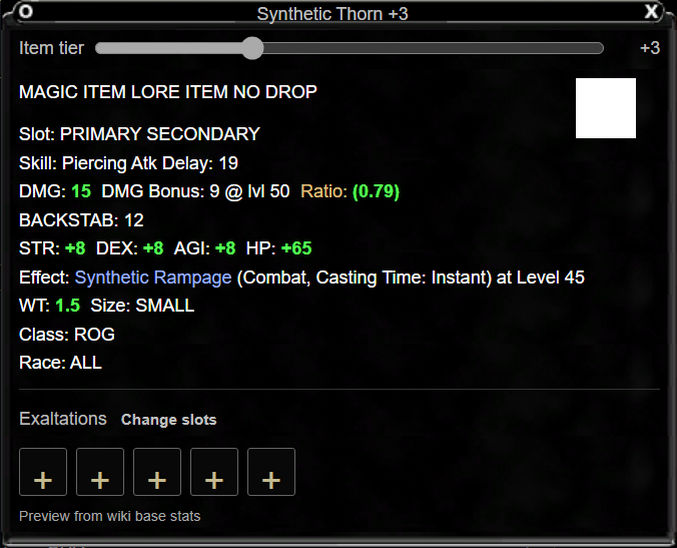

# Wiki item hovers: next-release execution plan

This app-only follow-up to published 0.9.9 reproduces the wiki item mouseovers
and removes the redundant Character sharing checkbox. Prepare a PR for the next
release; do not tag or publish it as part of this work. Published release media
and version history remain unchanged.

## Source and presentation contract

The reference is the live [Thornstinger item card](https://eqlwiki.com/Thornstinger),
verified against EQLWiki's registered EQLImmersive item-hover styles and Itembox
template. Use the existing frame artwork with provenance, centered silver title,
right-aligned icon, and compact inline stat groups. Parent items retain flags,
slots, skill/delay, weapon values, attributes/resists, effects, weight/size, class
and race. Text and wiki links remain escaped/validated, rather than inserting
remote HTML. Catalog/examine values keep their current meaning and green tier
changes. Presentation-derived weapon values must respect explicit zero and must
never become recorded character totals.

Keep the editable tier slider immediately below the title. Exaltation socket
controls remain after the item text. The delayed hover, keyboard access, immediate
slot tier badge, focused slider and viewport fit must survive the new frame.
The read-only share preview uses the same item text layout. Socket children show
only their linked name and effect; the full parent card remains available.

The wiki Character-sheet renderer has a separate staging PR for its compact
Exaltation presentation. App source changes do not deploy wiki skin code or
database templates.

## Sharing contract

The player reviews the interactive Character preview, then clicks **Share on my
User page**. That button is the explicit publication action; no second checkbox
is needed. Previewing, copying and saving a PNG never publish. Keep the bounded
sheet, authenticated current-account checks, User-page destination restriction,
fresh revision guards, retry receipts and host confirmation payload. This change
does not enable background Character sharing.

## Work and acceptance ledger

- [x] Shared wiki-style renderer and original frame assets, with provenance.
- [x] Character hover/editor and share review use consistent compact item text.
- [x] Remove visible share checkbox/reset/guard; preserve explicit Share action.
- [x] Native share fixture asserts no publication on preview/copy/save, then
  performs a successful attributed share with the single button.
- [x] Focused source checks and real Chromium rendering verify stats/effects,
  hover delay, tier slider/badge, narrow/large-font layout and local share actions.
- [x] Inspect screenshots and update this ledger. PR/CI status is tracked in the
  linked GitHub pull request; release publication remains separate.

Validation uses synthetic items and isolated profiles with a loopback wiki.
It does not claim a local installed-build or live game test. No dataset refresh,
production wiki edit or release publication is required.

## Validation evidence

The complete source suite passed, including the registered shared-renderer
checks. The real-main/preload Character workspace fixture passed with a private
profile and loopback wiki: preview/copy/save produced no page edits, a single
Share click performed the bounded User-page update, and account/revision retry
coverage remains unchanged. The real Chromium hover fixture passed with original
frame GIFs decoded, a centered title/right icon, linked effects, held-hover delay,
stable slider focus, immediate tier badges and 480px large-text viewport fit.
Explicit font choices override the default wiki Arial. Partial current readings
do not generate weapon defaults over explicit catalog overrides, including zero.

The capture contains no player records or game screenshots. All three frame GIFs
are unmodified tracked wiki artwork; their provenance is recorded in
`app/assets/wiki-item-card/README.md`. No local installed build was replaced.
